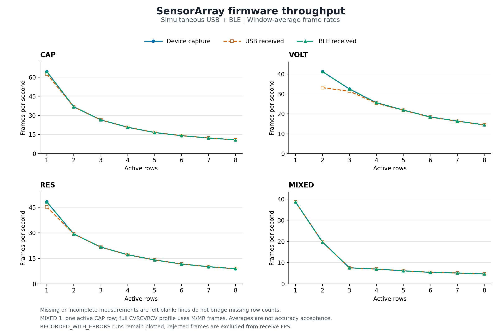

> **2026-11-16 当前调试状态 / Current debug status:** 板上 `a656d53`（160 MHz、`-O2`、CPU owner 诊断 ON），screen10 后已查询确认 CAP8。67 个 host 入口、目标构建与完整 BUILD/READY 通过；原 wrapper/assert/栈堆/watchdog 检查保留，首个移除 wrapper 的候选从未烧录。完整 120 秒 VOLT1：ADC CRC **0/84,943**，Capture/USB/BLE **65.59/65.62/44.16 FPS**；USB 7,873 帧内部连续，BLE 5,298 帧缺 2,572 个序号观察。BLE 比 screen09 提高 12.849%，但**仍 FAIL_BLE_THROUGHPUT**；600 秒稳定性另行运行中、结果待闭合；32 配置未运行。 / The board runs `a656d53` (160 MHz, `-O2`, CPU-owner diagnostics ON) and was query-verified in CAP8 after screen10. All 67 host entries, the target build and full BUILD/READY checks passed. Original wrapper/assertion/stack/heap/watchdog checks remain; the first candidate removing the wrapper was never flashed. The complete 120-second VOLT1 screen records **0/84,943 ADC CRC rejections** and **65.59/65.62/44.16 FPS capture/USB/BLE**: 7,873 internally consecutive USB frames and 5,298 BLE frames with 2,572 missing observations. BLE improves 12.849% over screen09, but **status remains FAIL_BLE_THROUGHPUT**; a separate 600-second stability run is in progress with results pending, and the 32-configuration suite is unrun. [完整双语记录 / Full bilingual record](docs/audit/cdc_recovery_acceptance_20261116.md).

> 后续进度 / Subsequent work: 同一 `a656d53` 的独立 `stability-01` USB+BLE 600 秒连续 CRC/健康诊断已开始，结果待闭合；它不是新优化候选，也不覆盖 screen10 的 BLE 不足。活动文件未被本次文档/归档读取或压缩。 / An independent 600-second USB+BLE CRC/health run, `stability-01`, has started on the same `a656d53`; results await closure. It is not a new optimization candidate and does not erase screen10's BLE deficit. This documentation/archive task has neither read nor compressed its active files.

# SensorArray — ESP32-S3 固件 / ESP32-S3 Firmware

SensorArray 面向 8×8 测量矩阵，支持 **1–8 个活动 S 行、每行 8 个 D 通道**。每行可选择电容 `CAP/C`、电压 `VOLT/V` 或电阻 `RES/R`；`ROWMODES` 可将不同模式组合在同一帧。模式切换的最小单位是一行，不是固定四点。

SensorArray is firmware for an 8×8 measurement matrix with **1–8 active S rows and 8 D channels per row**. Each row can measure capacitance (`CAP/C`), voltage (`VOLT/V`), or resistance (`RES/R`); `ROWMODES` combines these modes in one frame. A row is the smallest mode-switching unit; acquisition is not restricted to a fixed four-point scan.

仓库 / Repository: [ErrorChen/SensorArray](https://github.com/ErrorChen/SensorArray). 上位机兼容改动属于独立的 `ErrorChen/SensorArray_Software` 任务。 / Host compatibility changes belong to the separate `ErrorChen/SensorArray_Software` task.

## USB-OTG CDC 与 BLE 运转机制 / USB-OTG CDC and BLE operation

USB-OTG CDC 仍然是原生 USB Full Speed（12 Mbit/s 总线速率），不是 UART 转 USB。虚拟串口的波特率参数不限制总线速率；实际完整帧吞吐受主机读取、USB 调度、编码、队列和采集耗时共同影响，必须实测，不能用 12 Mbit/s 推算成已达成的有效吞吐。S3 OTG 内部 DMA 使用持续存活的内部 DRAM 缓冲；应用文本复制到 TinyUSB FIFO，不是 PSRAM 零拷贝。`USB?.dma` 查询实际控制器 enable 位。

USB-OTG CDC is native USB Full Speed (12 Mbit/s signaling), not a UART-to-USB link. Virtual baud settings do not set the USB wire rate. Complete-frame throughput still depends on host reads, bus scheduling, encoding, queues and acquisition, so signaling rate is not measured payload throughput. S3 internal OTG DMA uses persistent internal-DRAM buffers; application text is copied into TinyUSB FIFOs rather than DMA-read directly from PSRAM. `USB?.dma` reads the controller's actual enable bit.

双 CDC 用独立端点隔离正式口与调试口；正式口内 DATA 和 CTRL 在完整记录边界仲裁，CTRL 优先，已发送部分 DATA 不允许插入 CTRL 字节。短写、到期、断连和配置 epoch 均有独立状态；到期部分记录以换行重新建立边界并记丢弃，不补零或修改科学帧。调试口无人读取不能占住正式口。只有一个 TinyUSB owner，保留 DMA 停止确认、受控重启和 ROM 下载通路；不会因修改虚拟波特率或 DTR 自动进下载模式。

Separate CDC endpoints isolate the formal stream from debug output. DATA and CTRL share the formal byte stream only at complete-record boundaries: CTRL has admission priority, but cannot interrupt partially accepted DATA bytes. Short writes, expiry, disconnects and connection epochs have explicit state. An expired partial record gets a delimiter and a counted loss; scientific data is neither zero-filled nor relabeled. An unread debug port cannot retain the formal endpoint. One TinyUSB owner preserves the hardware DMA shutdown fence, controlled restart and ROM download path. Virtual baud or DTR changes do not trigger bootloader entry.

BLE DATA/CTRL 应用任务优先级为 7/8；`1e9fd19` 将正式 OTG USB owner 与 transport 从 6 提至 7，旧 Serial/JTAG owner 保持 6；DATA、LOG、控制终态使用有界容量，普通日志不能挤占保留终态槽。`BLELINK?` 报真实完成回调的 PHY/连接参数，`BLETX?` 报 SDK 调用时长和本地排队情况。SDK 接受、USB FIFO 接受、回调和主机完整 CRC 帧实收是不同统计层。CDC 回调没有分 lane 的字节数，所以 `USBQ` 对相应字段输出 `unknown`。IDF 单次 BLE GATT 调用内部的 BTC 队列仍可能阻塞；外层截止时间不证明内部调用已取消。

BLE DATA/CTRL application priorities are 7/8. In `1e9fd19`, the formal OTG owner and transport move from 6 to 7; the legacy Serial/JTAG owner stays at 6. DATA, LOG and terminal replies have bounded capacity; ordinary logs cannot consume reserved terminal slots. `BLELINK?` reports observed PHY/connection completion, while `BLETX?` reports SDK call timing and local queues. SDK acceptance, USB FIFO acceptance, callbacks and host CRC-valid complete-frame receipt are distinct layers. CDC callbacks provide no per-lane byte counts, so the corresponding `USBQ` values are `unknown`. The IDF GATT call can still block internally on its BTC queue; an outer deadline does not establish cancellation.

接口通过 VID/PID、板卡 MAC 序列号、接口编号和 `PROTO?` capability 共同识别，不能按 `/dev/ttyACM0` 枚举顺序猜测。新双 CDC 开发 PID 为 `303a:4042`，接口 0/1 正式、2/3 调试；旧 vendor 开发 PID `303a:4041` 不混用。当前 Linux 可利用已有 `cdc_acm` 驱动和 `dialout` 组访问；这不是对所有操作系统权限的保证。Windows 仍待实测。`BUILD?` 新增运行镜像 version/ELF SHA256，以免把工作区 HEAD 当作板上版本。

Discovery verifies VID/PID, the board's MAC-derived USB serial, interface number and `PROTO?` capability together, never tty enumeration order. The dual-CDC development PID is `303a:4042`, with interfaces 0/1 for formal traffic and 2/3 for debug; it is distinct from the optional vendor PID `303a:4041`. This Linux account can use its existing `cdc_acm` driver and `dialout` membership; this is not a universal OS permission guarantee. Windows remains untested. `BUILD?` adds running-image version and ELF SHA256 so a checkout HEAD is not mistaken for the flashed build.

本轮已完成及未完成项目以[阶段报告](docs/audit/usb_otg_ble_priority_20261114.md)和逐命令 manifest 为准。夹具仍为 S1D1/S8D8 10 kΩ、S4D4/S5D5 33 pF，其余悬空电容仅作为环境背景代理。AVDD/AVSS 的用户读数只用于注明来源的临时 RAM 校准；不执行 CAL=SAVE，不把背景扣除当作绝对精度验证。

Completed and pending checks are recorded in the [stage report](docs/audit/usb_otg_ble_priority_20261114.md) and command manifests. The fixture remains 10 kΩ at S1D1/S8D8 and 33 pF at S4D4/S5D5; floating-port capacitances are environmental-background proxies. User-supplied AVDD/AVSS readings support only explicitly sourced temporary RAM calibration. No CAL=SAVE is performed, and background subtraction is not absolute accuracy validation.

恢复闭环源码 / Recovery-loop source: `3a55543cb21fa3412ede26ee79c1cce7d8371804`; BUILD `3a55543`; app 1,591,088 B; binary SHA256 `59d3f07d772730692ea4a68e9af6437779ddfd24849c78f8fb9a03fbb2e31fee`; ELF SHA256 `d4ac82a199bd2bc8bb730b331225ffdbb94acd2c84c410cd675636da706e92e5`. [构建与 58 入口验证 / Build and 58-entry validation](docs/audit/artifacts/cdc_recovery_acceptance_20261116/recovery-candidate-01-validated-identity.json), [正式 CDC 恢复闭环 / Formal-CDC recovery loop](docs/audit/artifacts/cdc_recovery_acceptance_20261116/cdc-rom-01-verified-loop.json).

更新时由 USBBOOT 显式请求 ROM 下载，owner 在同一个 250 ms 总期限内停止 USB 事件、保持至少 20 ms detach 窗口、确认控制器 reset 后才允许 CPU restart；20 ms 是工程间隔，不是模拟节点或主机收到终态的证明。恢复模式的 RTC 标记不再在启动选择时清除，普通 RESTART 和重复 early panic 保留 USJ；显式 USBBOOT 完成准备并读回 ROM 启动标志后才解除。完整 BUILD 哈希直接读取应用描述符 32 字节，避免 IDF 日志缓存长度仅 9 位造成截断。主机只读查询会保留未关联的精确 UNKNOWN 错误并在原期限内等待真实回复，模式 setter/终态 ID 门控不变。

Updates explicitly request ROM download using USBBOOT. Within the same 250 ms transaction deadline, the owner stops USB events, holds an engineering detach window of at least 20 ms and verifies controller reset before CPU restart. That interval proves neither analog stability nor terminal receipt. The RTC recovery latch now survives backend selection, ordinary RESTART and repeated early panic; only an explicit, prepared USBBOOT with a read-back ROM flag releases it. BUILD reads all 32 descriptor hash bytes rather than the IDF's nine-character logging cache. Read-only host queries retain an uncorrelated exact UNKNOWN error while awaiting the real reply within the original deadline; mode setter and terminal-ID checks remain strict.

本机 esptool 4.12 的 RTS-only 退出下载未启动应用；明确清 DTR 也未恢复，根因仍未完全确认。新的 app-only 助手在核对镜像、分区、MAC 和写入哈希后，仅调用一次官方 S3 watchdog 软件复位，独立核验新枚举和 BUILD。该路径已实测，不等于任意硬件故障都能免物理操作恢复。旧失败与尚未运行的早崩溃注入均保留在阶段报告。

Here, esptool 4.12's RTS-only download exit did not start the application; explicitly clearing DTR also failed, so the full cause remains unresolved. After image, partition, MAC and flash-hash checks, the new app-only helper calls the official S3 watchdog software reset once, with independent enumeration and BUILD verification. This path has hardware evidence, but arbitrary hardware failures are not guaranteed to recover without physical access. Prior failures and unrun early-crash injection remain in the stage report.

## 2026-11-16 `-O2` 候选与安全检查 / `-O2` candidate and retained safety checks

ESP-IDF 5.5.5 的原 Kconfig 只在 debug/core-dump/GDB 条件下启用 `FREERTOS_TASK_FUNCTION_WRAPPER`。单纯改为 performance 会移除任务意外返回时的 log/abort 检查，所以[第一候选被拒绝且未烧录](docs/audit/artifacts/cdc_recovery_acceptance_20261116/compiler-perf-01-scope-rejected.json)。`a656d53` 在项目 `main/kconfigs/Kconfig.compat` 中仅增加 S3+PERF 的同一 SDK symbol 条件，main 编译 guard 在 wrapper 缺失时拒绝构建；没有修改 SDK、开启 GDB/core dump 或另写替代 wrapper。

ESP-IDF 5.5.5's original Kconfig enables `FREERTOS_TASK_FUNCTION_WRAPPER` only for debug/core-dump/GDB configurations. Simply selecting performance removes the log/abort check for an unexpectedly returning task, so [the first candidate was rejected and never flashed](docs/audit/artifacts/cdc_recovery_acceptance_20261116/compiler-perf-01-scope-rejected.json). `a656d53` adds only the S3+PERF condition to that same SDK symbol in project `main/kconfigs/Kconfig.compat`; a main compile guard rejects a missing wrapper. It neither edits the SDK, enables GDB/core dump nor substitutes a new hand-written wrapper.

18 个真实 Kconfig 边界、6 个 guard 编译用例通过，3,769 个全树 symbol 中该扩展只改变 wrapper。当前配置保留 assertions、strong stack check、heap poisoning、task watchdog 和 end-of-stack watchpoint；CPU 仍 160 MHz，CRC 门槛/协议/队列/限速不变。最终 ELF 已确认 `vPortTaskWrapper` 调用任务、返回后 log→abort，以及初始 task stack PC 实际引用 wrapper。**这证明链接/初始栈路径，不是实机任务返回注入通过**；该故障注入为 NOT_RUN。证据：[范围](docs/audit/artifacts/cdc_recovery_acceptance_20261116/compiler-perf-02-scope.json)、[独立审查](docs/audit/artifacts/cdc_recovery_acceptance_20261116/performance-wrapper-independent-review-01.json)、[ELF](docs/audit/artifacts/cdc_recovery_acceptance_20261116/compiler-perf-02-wrapper-elf-review.json)。

Eighteen real Kconfig boundary cases and six guard-compilation cases passed; the extension changes only the wrapper among 3,769 full-tree symbols. Assertions, strong stack checks, heap poisoning, task watchdog and end-of-stack watchpoint remain enabled. CPU stays at 160 MHz, with unchanged CRC criterion, protocol, queues and rate limits. Final ELF inspection confirms the wrapper calls the task, reaches log→abort on return, and is the actual initial task-stack PC. **This verifies linked code/stack initialization, not a hardware return-fault injection**, which is NOT_RUN. Evidence: [scope](docs/audit/artifacts/cdc_recovery_acceptance_20261116/compiler-perf-02-scope.json), [independent review](docs/audit/artifacts/cdc_recovery_acceptance_20261116/performance-wrapper-independent-review-01.json), [ELF](docs/audit/artifacts/cdc_recovery_acceptance_20261116/compiler-perf-02-wrapper-elf-review.json).

[67 入口与构建身份](docs/audit/artifacts/cdc_recovery_acceptance_20261116/compiler-perf-02-validated-identity.json)及[完整 BUILD/READY](docs/audit/artifacts/cdc_recovery_acceptance_20261116/compiler-perf-02-boot-verification.json)已完成。新 screen10 实测已闭合，旧 screen09 数字仅作历史对照。

The [67-entry/build identity](docs/audit/artifacts/cdc_recovery_acceptance_20261116/compiler-perf-02-validated-identity.json) and [full BUILD/READY verification](docs/audit/artifacts/cdc_recovery_acceptance_20261116/compiler-perf-02-boot-verification.json) are complete. Screen10 is now closed; screen09 numbers remain a historical comparison.

| 指标 / Metric | screen09 `-Og` | screen10 `-O2` |
|---|---:|---:|
| Capture / USB / BLE FPS | 57.787813 / 57.664438 / 39.133976 | 65.594513 / 65.616123 / 44.162295 |
| USB trusted frames / internal missing observations | 6,920 / 0 | 7,873 / 0, seq 1331–9203 |
| BLE trusted frames / missing observations | 4,695 / 2,223 | 5,298 / 2,572 |
| ADC rejected / checked reads | 0 / 74,721 | 0 / 84,943 |
| USB/BLE ASCII CRC / identity / wire-contract errors | all 0 | all 0 |
| USB S1D2 X12 / BLE X12 invalid points | 467 / 340 | 740 / 465 |
| ASYNC_LOG Δrun / own observation span | 13.494264% | 14.849499% |
| Overall acceptance | FAIL_BLE_THROUGHPUT | **FAIL_BLE_THROUGHPUT** |

120.000122 秒内 BLE 实收提高 12.849%，但采集也更快，BLE pool 的独立 119.677834 秒 BL50 窗仍 `dropD +2533`；不能只看 FPS 增长宣布背压消失。USB 连续性按单身份、有序数量、首末 seq 差及空 gap 列表核验，USBQ 在 120.404974 秒查询窗内 dDrop/cDrop/expired/partial 增量均 0。ADC 0/84943 属于 119.069615 秒健康窗口；浮空 S1D2 X12 如实保留，未观测到 WDT/MFAULT/reset不等于无限运行保证。结束后 CAP8 已查询确认，完整 600 秒/32 配置及绝对精度仍未验收。

Over 120.000122 seconds BLE receipt improves 12.849%, but capture is faster too; the independent 119.677834-second BL50 window still reports `dropD +2533`. Higher FPS therefore does not mean backpressure disappeared. USB contiguity is checked from one identity, ordered count, first/last sequence distance and an empty gap list; USBQ dDrop/cDrop/expired/partial increments are zero over its 120.404974-second query span. The ADC result covers 119.069615 seconds of health records. Floating S1D2 X12 remains invalid, and no observed WDT/MFAULT/reset is not an indefinite-run guarantee. CAP8 was query-verified afterward; full 600-second/32-configuration and absolute-accuracy acceptance remain pending.

[screen10 判定](docs/audit/artifacts/cdc_recovery_acceptance_20261116/screen-10/screen-10-verdict.json)、[09→10 各层/CPU 对照](docs/audit/artifacts/cdc_recovery_acceptance_20261116/screen-10/screen-09-10-layer-cpu-comparison-01.json)保留独立窗口；不跨 boot 相减累计量、不把 SDK wall−owner run 叫 blocked。13 个 compiler-perf/screen10 已关闭原始流共 21,033,025 B，压缩后 2,490,426 B，均解压逐字节及 SHA 回验通过，[索引](docs/audit/artifacts/cdc_recovery_acceptance_20261116/screen-10/archive-index-01.json)保留所有原始文件，未覆盖旧证据。

The [screen10 verdict](docs/audit/artifacts/cdc_recovery_acceptance_20261116/screen-10/screen-10-verdict.json) and [09→10 layer/CPU comparison](docs/audit/artifacts/cdc_recovery_acceptance_20261116/screen-10/screen-09-10-layer-cpu-comparison-01.json) retain independent windows. Cumulative counters are not subtracted across boots, and SDK wall−owner run is not blocked time. Thirteen closed compiler-perf/screen10 recordings total 21,033,025 bytes, compressed to 2,490,426 bytes; every file passed decompression byte/SHA verification. The [index](docs/audit/artifacts/cdc_recovery_acceptance_20261116/screen-10/archive-index-01.json) retains all originals without overwriting historical evidence.

## 2026-11-16 screen09（历史）：元数据单遍解析 / Historical screen09: single-pass metadata parsing

`dafaf9b` 只优化 `sensorarrayTransportParseFrameMeta`：输出 owner 在入队前，按一次 token 遍历从已复制的不可变帧字节提取字段，避免每个字段反复扫描整段 header。它保留各 gen/rid 域、重复字段/数值边界、首行规则和 CAP preview，既不从最新全局状态重新盖章，也不改 encoder、科学 CRC、队列容量、调度预算或任何原有 stdout 输出。[66,896 个完整 slot 差分](docs/audit/artifacts/cdc_recovery_acceptance_20261116/transport-meta-single-pass-host-01.json)与 ASan/UBSan 实际通过；20 个完整 encoder 帧保持原始字节及 CRC。LSan 因执行环境 ptrace 限制为 NOT_RUN，首次失败原样保留，不能写成泄漏检查通过。

`dafaf9b` optimizes only `sensorarrayTransportParseFrameMeta`. Before enqueue, the output owner extracts metadata from the copied immutable frame in one token traversal, replacing repeated whole-header scans per field. Generation/request domains, duplicate/numeric boundaries, first-line rules and CAP preview remain unchanged. It neither restamps from current globals nor changes the encoder, scientific CRC, queue capacity, scheduling budgets or existing stdout output. The [66,896 complete-slot differential cases](docs/audit/artifacts/cdc_recovery_acceptance_20261116/transport-meta-single-pass-host-01.json) and ASan/UBSan actually passed; 20 complete encoder frames retain their original bytes and CRC. LSan is NOT_RUN because of the environment's ptrace limitation; the initial failure is preserved, not represented as a passing leak check.

| 指标 / Metric | screen08 | screen09 |
|---|---:|---:|
| Capture / USB / BLE FPS | 59.184655 / 59.173785 / 33.118267 | 57.787813 / 57.664438 / 39.133976 |
| USB trusted frames; internal missing observations | 7,101; 0 | 6,920; 0, seq 1600–8519 |
| BLE trusted frames; missing observations | 3,974; 3,128 | 4,695; 2,223 |
| ADC rejected / checked reads | 0 / 76,841 | 0 / 74,721 |
| USB / BLE ASCII CRC and identity errors | all 0 | all 0 |
| USB S1D2 X12 invalid points | 525 | 467 |
| ASYNC_LOG Δrun / own observation span | 24.600562% | 13.494264% |
| 整体验收 / Overall acceptance | FAIL_BLE_THROUGHPUT | **FAIL_BLE_THROUGHPUT** |

此次 BLE 实收提高 18.16%，ASYNC_LOG 独立窗口比例下降 11.1063 个百分点，支持该热路径有实际开销；并不证明全部剩余瓶颈已定位，采集速率本次也下降。USB 内部连续由 ordered 数量、首末序号差及空 gap 列表共同核验；BLE 收到的分片无校验/组装错误，仍存在完整帧背压。ADC 0/74,721 属于 118.765452 秒健康日志窗口，不是永久零错保证。未观测到 WDT/MFAULT/reset，X12 保留无效；绝对精度仍未评估。

BLE receipt increased by 18.16% in this comparison, while ASYNC_LOG's independent-window ratio fell 11.1063 percentage points, supporting a material cost in this path. It does not identify every remaining bottleneck; capture rate also fell in this run. USB contiguity is verified jointly from ordered count, first/last sequence distance and an empty gap list. Received BLE fragments pass checksum/assembly checks, while complete-frame backpressure remains. The ADC result covers a 118.765452-second health-record window, not indefinitely error-free operation. No WDT/MFAULT/reset was observed, X12 remains invalid, and absolute accuracy is unevaluated.

[完整 BUILD/READY 身份](docs/audit/artifacts/cdc_recovery_acceptance_20261116/frame-meta-01-boot-verification.json)、[66 入口与构建](docs/audit/artifacts/cdc_recovery_acceptance_20261116/frame-meta-01-validated-identity.json)、[screen09 判定](docs/audit/artifacts/cdc_recovery_acceptance_20261116/screen-09/screen-09-verdict.json)和[08→09 各层/CPU 对照](docs/audit/artifacts/cdc_recovery_acceptance_20261116/screen-09/screen-08-09-layer-cpu-comparison-01.json)保留窗口和来源。结束后 CAP8 已查询确认；CPU 配置仍 ON、160 MHz、`-Og`，下一 `-O2` 候选尚未作为此结果测试。各 CPU 角色窗口不能合计，SDK wall−owner run 仍不是 blocked。

The [full BUILD/READY identity](docs/audit/artifacts/cdc_recovery_acceptance_20261116/frame-meta-01-boot-verification.json), [66-entry/build record](docs/audit/artifacts/cdc_recovery_acceptance_20261116/frame-meta-01-validated-identity.json), [screen09 verdict](docs/audit/artifacts/cdc_recovery_acceptance_20261116/screen-09/screen-09-verdict.json) and [08→09 layer/CPU comparison](docs/audit/artifacts/cdc_recovery_acceptance_20261116/screen-09/screen-08-09-layer-cpu-comparison-01.json) retain source/window details. CAP8 was query-verified after capture. Profiling remains ON at 160 MHz with `-Og`; the next `-O2` candidate has not been tested as part of this result. Per-role CPU windows cannot be summed, and SDK wall−owner run is not blocked time.

## 2026-11-16 screen08（历史）：分配生命周期修复与日志统计清理 / Historical screen08: allocation lifetime and unused log statistics

当前 `b9ebe2f-dirty` 包含 `c670897` 的 ADS SPI 部分缓冲分配 P1 修复：分配成功前指针仅保存在局部，避免失败路径释放后 Init/Deinit 再次释放；S3/非 S3 的真实生产 Init/Deinit 各 16 组合回归通过。`98b760c` 只移除不可达 PREC20 与已停用 legacy netStatus 消费的统计，活跃输出按字节对照不变。`b9ebe2f` 本身修正主机 BLE 清理测试对总 deadline 耗尽时第四个错误的断言，并新增确定性用例，**没有放宽生产 timeout**。原失败日志保留。[修改范围](docs/audit/artifacts/cdc_recovery_acceptance_20261116/output-trim-source-diff-01.json)、[66 入口与构建身份](docs/audit/artifacts/cdc_recovery_acceptance_20261116/output-trim-02-validated-identity.json)、[完整 BUILD/READY 核验](docs/audit/artifacts/cdc_recovery_acceptance_20261116/output-trim-02-boot-verification.json)。

Current `b9ebe2f-dirty` includes the `c670897` ADS SPI partial-buffer-allocation P1 fix: pointers remain local until allocation succeeds, avoiding a second free by Init/Deinit after partial failure. Sixteen production Init/Deinit combinations passed for each S3/non-S3 path. `98b760c` removes only statistics consumed by unreachable PREC20 and disabled legacy netStatus; active output remains byte-equivalent. `b9ebe2f` itself corrects the host BLE-cleanup test for the legitimate fourth error when its total deadline expires and adds a deterministic case; **production timeouts are unchanged**. Original failure logs remain. See the [change scope](docs/audit/artifacts/cdc_recovery_acceptance_20261116/output-trim-source-diff-01.json), [66-entry/build identity](docs/audit/artifacts/cdc_recovery_acceptance_20261116/output-trim-02-validated-identity.json) and [full BUILD/READY verification](docs/audit/artifacts/cdc_recovery_acceptance_20261116/output-trim-02-boot-verification.json).

| 指标 / Metric | screen07 历史 / Historical | screen08 当前 / Current |
|---|---:|---:|
| 完整采集窗 / Complete capture window | 120.000117 s | 120.000130 s |
| Capture / USB / BLE FPS | 59.900009 / 59.812416 / 32.390344 | 59.184655 / 59.173785 / 33.118267 |
| USB 可信帧；内部缺少序号 / Trusted frames; internal missing observations | 7,178; 1 | 7,101; **0**, seq 1259–8359 |
| BLE 可信帧；缺少序号 / Trusted frames; missing observations | 3,886; 3,293 | 3,974; 3,128 |
| ADC CRC 拒收 / Checked-read rejections | 0 / 76,128 | 0 / 76,841 |
| USB ASCII CRC / identity errors | 0 / 0 | 0 / 0 |
| BLE ASCII CRC / identity errors | 0 / 0 | 0 / 0 |
| USB S1D2 无效点 / Invalid points | 406 × X12 | 525 × X12 |
| ASYNC_LOG Δrun / 独立观测跨度 / Own observation span | 24.974627% | 24.600562% |
| 总体验收 / Overall acceptance | FAIL_BLE_THROUGHPUT | **FAIL_BLE_THROUGHPUT** |

screen08 的 USB 零缺口由有序可信帧数、首末序号差和空 gap 列表共同验证，不把缺失的 `missing_frames` 字段默认为零。各层独立窗口仍分开：USBQ 在 120.592613 秒查询窗内 `dDrop/cDrop/expired/partial` 增量均 0；BL50 在 119.650096 秒窗内 `dropD +3037`，不能与主机 3128 缺口相加。ADC 0/76841 覆盖 118.996649 秒健康日志跨度；完整原始流未观测到 WDT/MFAULT/reset，但不证明未记录事件绝不存在。结束后 CAP8 cleanup 已查询确认，绝对精度仍未评估。

Screen08's zero internal USB gap is established from ordered trusted-frame count, first/last sequence distance and an empty gap list, not by defaulting an absent `missing_frames` field to zero. Layer windows remain separate: USBQ increments for `dDrop/cDrop/expired/partial` are all zero over a 120.592613-second query span; BL50 reports `dropD +3037` over 119.650096 seconds, which cannot be added to the host's 3,128 missing observations. The ADC result covers a 118.996649-second health-record span. No WDT/MFAULT/reset was observed in the recorded streams, without ruling out unrecorded events. CAP8 cleanup was query-verified; absolute accuracy remains unevaluated.

ASYNC_LOG 比例仅降低约 0.374 个百分点，BLE 仍约 33 FPS，**不能宣称日志计算是主要原因或瓶颈已修复**。两次 boot 的累计值不相减，仅比较各自角色独立窗口内的差分与比例；stale/未观测仍 unknown，SDK wall−owner run 仍不能称 blocked。[新判定](docs/audit/artifacts/cdc_recovery_acceptance_20261116/screen-08/screen-08-verdict.json)和[分层/CPU 对照](docs/audit/artifacts/cdc_recovery_acceptance_20261116/screen-08/screen-07-08-layer-cpu-comparison-01.json)保留全部分母、原始身份和限制；历史 screen07 及更早失败不改写。

ASYNC_LOG's ratio fell only about 0.374 percentage points while BLE remains around 33 FPS. **This does not establish log computation as the primary cause or a repaired bottleneck.** Cumulative counters are never subtracted across boots; only independently computed per-role deltas/ratios are compared. Stale/unobserved values remain unknown, and SDK wall−owner run is still not blocked time. The [new verdict](docs/audit/artifacts/cdc_recovery_acceptance_20261116/screen-08/screen-08-verdict.json) and [layer/CPU comparison](docs/audit/artifacts/cdc_recovery_acceptance_20261116/screen-08/screen-07-08-layer-cpu-comparison-01.json) preserve denominators, identities and limits. Screen07 and earlier failures remain unchanged historical evidence.

## 2026-11-16 CPU 诊断首轮 screen07（历史） / First CPU diagnostic screen07 (historical)

[完整 BUILD 与启动身份核验 / Full BUILD and boot identity](docs/audit/artifacts/cdc_recovery_acceptance_20261116/cpu-owner-01-boot-verification.json)将 app-only 写入、完整 64 个十六进制字符的 ELF SHA256、`READY=1` 和同 session 的 CAP8 状态连接起来；ELF SHA256 与 app binary SHA256 分别保存，不能互换。此镜像使用 ESP-IDF 5.5.5，启动选中 2 MHz、`gpio_tail_required`。CPU profiling 在该诊断构建中开启，正常 `sdkconfig.defaults` 仍关闭；[65 入口结果](docs/audit/artifacts/cdc_recovery_acceptance_20261116/cpu-owner-02-tests-manifest.json)保留前一轮单个 harness 缺声明的失败记录，没有把它改写成固件失败或删除。

The [boot verification](docs/audit/artifacts/cdc_recovery_acceptance_20261116/cpu-owner-01-boot-verification.json) links the app-only write, full 64-hex-digit ELF SHA256, `READY=1` and same-session CAP8 state. ELF and app-binary hashes are recorded separately. This ESP-IDF 5.5.5 image selected 2 MHz with `gpio_tail_required`. CPU profiling is enabled for this diagnostic build; normal defaults remain disabled. The [65-entry results](docs/audit/artifacts/cdc_recovery_acceptance_20261116/cpu-owner-02-tests-manifest.json) preserve the earlier missing-declaration harness failure without relabeling it as a firmware failure or deleting it.

| 指标 / Metric | screen07 实测 / Observation |
|---|---:|
| 完整采集窗 / Complete capture window | 120.000117 s |
| Capture / USB / BLE | 59.900009 / 59.812416 / 32.390344 FPS |
| USB 可信帧 / Trusted frames; missing sequence observations | 7,178; 1 |
| BLE 可信帧 / Trusted frames; missing sequence observations | 3,886; 3,293 |
| ASCII CRC / identity / wire-contract errors | USB 0 / 0 / 0; BLE 0 / 0 / 0 |
| 两端共同帧原字节一致 / Common frames with identical original bytes | 3,884 / 3,884 |
| ADC CRC 拒收 / Rejected checked ADC reads | 0 / 76,128; diagnostic span 118.796879 s |
| 科学无效点 / Invalid scientific points | USB 406 × X12; BLE 223 × X12; retained as invalid |
| BLE pool `dropD` / `dropL` / `dropC` 增量 / Delta | +3,177 / 0 / 0; separate 119.823636 s BL50 receipt window |
| 完整 STK50 内存观测 / Memory from complete STK50 records | free 8,294,036 B; boot-lifetime minimum 8,290,104 B |
| WDT / MFAULT / reset | 未观测到；日志缺失仍是证据边界 / Not observed; limited to available recordings |
| 整体验收 / Overall acceptance | **FAIL_BLE_THROUGHPUT**; absolute accuracy NOT_EVALUATED |

ADC 分母是健康日志首末的已校验读数增量，含重试尝试，不是帧数，也不是精确采集起止。USB/BLE 缺口各按本端首末可信帧统计，不能相减或与 BL50 丢弃直接相加。收到的 BLE 分片没有校验或组装错误，仍不表示完整科学帧没有丢弃。原始记录、窗口和计数见 [screen07 判定](docs/audit/artifacts/cdc_recovery_acceptance_20261116/screen-07/screen-07-verdict.json)；旧 screen05/06 的 0/79,417、0/76,069 及所有失败基线继续保留。

The ADC denominator is the checked-read delta between complete health records, including retry attempts, not frame count or exact capture endpoints. USB/BLE gaps use each receiver's own trusted sequence range and cannot be subtracted or added directly to BL50 drops. Received BLE fragments passed checksum and assembly checks, which does not imply that no complete scientific frames were discarded. The [screen07 verdict](docs/audit/artifacts/cdc_recovery_acceptance_20261116/screen-07/screen-07-verdict.json) retains the raw-evidence links, windows and counters. Prior screen05/06 results of 0/79,417 and 0/76,069, and all failed baselines, remain historical evidence.

`cpu_owner_v1` 提供只读 `CPUOWNER?0` 至 `CPUOWNER?6`。七个应用 owner 仅在自身自然 checkpoint 中、最多每秒自采一次 `vTaskGetInfo(NULL, …, pdFALSE, eReady)`，不扫描栈、不保存外部 task handle、不增加 delay 或改变预算/优先级。查询只读短锁保护的快照，带 session、taskNumber、采样前后时间、累计 runUs 和 age；角色多 writer 冲突会保持 unavailable 到下一 boot。配置关闭、从未采到或过期都不能解释为零 CPU。实际新增本地静态存储 456 B，不包括 FreeRTOS trace/runtime 的全局开销。

`cpu_owner_v1` exposes read-only `CPUOWNER?0` through `CPUOWNER?6`. The seven application owners self-sample `vTaskGetInfo(NULL, …, pdFALSE, eReady)` at their natural checkpoints at most once per second, without stack scans, retained external task handles, new delays or changes to budgets/priorities. Queries copy a briefly locked snapshot containing session, task number, the sampling bracket, cumulative runtime and age. A conflicting writer makes that role unavailable until boot. Disabled, unseen or stale observations are not zero CPU. The new local static storage is 456 B, excluding global FreeRTOS trace/runtime overhead.

| Role | 本角色独立跨度 / Own observation span (s) | switch-out Δrun (s) | Δrun / own span |
|---|---:|---:|---:|
| 0 BLE_TX | 120.095170 | 17.903690 | 14.9079% |
| 1 TRANSPORT | 119.846299 | 9.070485 | 7.5684% |
| 2 ASYNC_LOG | 120.182388 | 30.015103 | 24.9746% |
| 3 SERIAL_TX | 120.609289 | 11.569529 | 9.5926% |
| 4 BLE_CTRL | unknown: stale | unknown | unknown |
| 5 SERIAL_CTRL | 120.285279 | 0.853506 | 0.7096% |
| 6 WIFI_CTRL | unknown: not_observed | unknown | unknown |

这些比例不是同步 CPU 利用率表，不能合计；runUs 仅在切出时累计，未含正在运行的片段，可能含 ISR 及 SDK 以外工作。独立 BLESVC 查询窗记录 12,991 次完成调用、SDK 墙钟增量 62.018883 s（平均 4.773988 ms）；**不能用 SDK 墙钟减 BLE_TX runUs 得到 blocked**。SDK/IDLE 任务、总 CPU、就绪等待与阻塞归因仍 unknown；开启 profiling 的两镜像对比也不是受控开销实验。[可复跑分析与各角色窗口](docs/audit/artifacts/cdc_recovery_acceptance_20261116/screen-07/screen-07-cpu-owner-deltas-01.json)及[完整查询契约](docs/integration/firmware_host_contract.md#cpu-owner-只读运行计数契约--read-only-owner-runtime-contract)保留这些限制。

These ratios are not a simultaneous CPU-utilization table and must not be summed. Runtime is accumulated only at switch-out; it excludes the open running slice and may include ISR and non-SDK work. A separate BLESVC query window records 12,991 completed calls and 62.018883 s of SDK wall time, averaging 4.773988 ms. **SDK wall minus BLE_TX runtime is not blocked time.** SDK/idle tasks, total CPU utilization and ready-versus-blocked attribution remain unknown. Comparing images with and without profiling is not a controlled overhead experiment. The [reproducible per-role analysis](docs/audit/artifacts/cdc_recovery_acceptance_20261116/screen-07/screen-07-cpu-owner-deltas-01.json) and [query contract](docs/integration/firmware_host_contract.md#cpu-owner-只读运行计数契约--read-only-owner-runtime-contract) preserve these limits.

## 2026-11-16 首轮双通路筛查 / First dual-link screen

[完整 120 秒实录与判定 / Full 120-second evidence and verdict](docs/audit/artifacts/cdc_recovery_acceptance_20261116/screen-01/screen-01-verdict.json)：**FAIL**。运行源码 `3a55543`，VOLT 1 行，USB CDC0 和 BLE 同时记录，独立 CDC1 用于 ADC 诊断；相同会话/配置身份。启动 SPI 为请求 550 kHz、驱动观测 551 kHz，不能拿前一个 boot 的 850 kHz 解释本窗口。

The complete VOLT1 screen **failed** on `3a55543`. Formal CDC0 and BLE were recorded simultaneously, with separate CDC1 diagnostics and matching session/configuration identity. This boot selected 550 kHz (driver-observed 551 kHz); the preceding boot's 850 kHz is not this run's clock.

| 指标 / Metric | 本轮实测 / Observation |
|---|---:|
| 科学采集窗口 / Scientific capture window | 120.0001 s |
| Capture | 64.563554 FPS |
| USB 完整可信帧 / USB complete trusted frames | 62.532747 FPS; 7,502 frames; 239 missing sequence observations |
| BLE 完整可信帧 / BLE complete trusted frames | 43.370896 FPS; 5,204 frames; 2,537 missing sequence observations |
| ASCII CRC / configuration identity errors | USB 0 / 0; BLE 0 / 0 |
| ADC SPI CRC 拒绝 / ADC SPI CRC rejection | 4,378 / 102,828 = **4.257595%**, limit 2.5% |
| CRC 诊断跨度 / CRC diagnostic span | 118.992248 s inside capture; first/last complete ADSHEALTH receipts |
| MFAULT / reset | Not observed in the recorded window; absence is limited to observed logs |
| 绝对精度 / Absolute accuracy | NOT_ACCEPTED; approximate DMM RAM rails and floating-port background remain nonprecision references |

ADC 分母是已校验有效 even/odd 读数与 CRC 拒绝的增量之和，包含有限重试，不能再次加 retry 或用帧数代替。两通路缺口是各自的可信序号观察缺口，不能相减为独立层丢失。扫描汇总 `scope=all_candidates` 包含被淘汰档位，不等于选中档错误率。先定位运行期错误及有界输出队列背压，再重做筛查；600 秒与32配置测试不以本次失败替代。

The ADC denominator sums valid-even, valid-odd and rejected checked reads, including bounded retries; retries must not be added again and frame count is not the denominator. Each transport's missing count refers to its own trusted sequence observations, not disjoint losses. Startup `scope=all_candidates` includes rejected rates and is not the selected-rate error ratio. Runtime CRC and bounded-output backpressure must be addressed before repeating the screen and starting the 600-second/32-configuration tests.

## 2026-11-16 第二轮筛查与 CRC 定位 / Second screen and CRC investigation

第二轮已烧录源码 / Second-screen source: `1e9fd19799afa13bbf4584d986f5a797c57ec74d`; app SHA256 `06d15e24fa2f60961789645cb1b46b46b4f06de4b53445861315444a695c3f1c`; ELF SHA256 `c7bdc7a11bf87aec5a99a720cf88b796484c9cb2f129669da3827360dcaf82dc`. 58 个 host 入口和目标构建通过，烧录后完整 BUILD 已核对。 / All 58 host entries and the target build passed; the full running BUILD hash was verified after flashing.

[第二轮完整 120 秒 / Second full 120-second screen](docs/audit/artifacts/cdc_recovery_acceptance_20261116/screen-02/screen-02-verdict.json)仍为 **FAIL_BLE_THROUGHPUT**，不是整体验收通过。 / It remains **FAIL_BLE_THROUGHPUT**, not full acceptance.

| 指标 / Metric | screen-02 |
|---|---:|
| 科学采集窗口 / Scientific capture window | 120.000091 s |
| Capture | 68.047855 FPS |
| USB 完整可信帧 / USB complete trusted frames | 68.028989 FPS; 8,164 frames; 1 missing sequence observation |
| BLE 完整可信帧 / BLE complete trusted frames | 35.347479 FPS; 4,241 frames; 3,923 missing sequence observations |
| ADC SPI CRC 拒收 / ADC SPI CRC rejection | 2,152 / 107,124 = 2.008887% |
| 本 boot SPI 请求 / 驱动观测 / Requested / observed SPI clock | 750,000 / 754,000 Hz |
| ASCII CRC / configuration identity errors | USB 0 / 0; BLE 0 / 0 |
| MFAULT / reset | Not observed in the recorded window |

正式 USB 缺口大幅减少，但 BLE pool 的 dropD 增量为 3,690，上一轮为 0；原 transport 层排队拒绝减少，压力转移到 BLE 服务环节。各计数器查询跨度与完整帧采集窗口不同，不把它们直接相加为实收缺口。不能靠扩大队列消除持续服务率差额。两轮启动选速不同，因此不能把 CRC 下降归因于任务优先级修改。详见[分层对照](docs/audit/artifacts/cdc_recovery_acceptance_20261116/screen-02/ble-service-review-01.json)。

Formal USB loss fell substantially, but BLE pool dropD increased by 3,690 versus zero in screen-01. Admission pressure moved from the transport queue into BLE service. Counter-query spans differ from the complete-frame capture window, so their increments are not added to infer receiver gaps. A larger queue cannot remove a sustained service-rate deficit. Different boot-selected SPI clocks also prevent attribution of the lower CRC ratio to task priority alone.

用户随后提出可考虑 5% 错误率，同时要求先查明根因。本轮将 5% 作为待评估的调试容忍度，尚未改变启动选速的 2.5% 门限；原先按 2.5% 判定的 FAIL 保留。任何容忍度都不允许 CRC 错误值进入科学帧、缓存或 PGA 决策。

The user subsequently suggested considering 5% while prioritizing root-cause repair. It is a prospective debugging tolerance, not an implemented change to the 2.5% startup qualification. Historical failures retain their original criteria. No tolerance permits CRC-rejected values into scientific frames, caches or PGA decisions.

[249 条完整坏包的独立复算](docs/audit/artifacts/cdc_recovery_acceptance_20261116/ads-runtime-root-cause-01.json)全部只差 CRC 最低位，其中 248 条为 0→1、1 条为 1→0。记录是限量诊断子集，不代表所有失败包。该方向性支持调查末位采样/DOUT-DRDY 交接，但不能单凭它认定硬件或驱动根因。正在实现保持 SPI 时钟不变的连续/单次转换、PGA1/bypass 对照，以及单次保持数据的重复诊断读取；这些读取不是科学样本，恢复状态必须独立验证。2 秒总期限包含 500 ms 收尾预留；未完成组必须标 incomplete。

Independent recomputation of 249 complete bad packets found only CRC bit 0 differing: 248 transitions from 0 to 1 and one from 1 to 0. These are bounded diagnostic records, not every failure. This directional pattern motivates investigation of final-bit sampling and DOUT/DRDY handoff without establishing either a hardware or driver cause. A constant-clock continuous/pulse and PGA1/bypass comparison, including held-result diagnostic rereads, is being implemented. These reads are not scientific samples; restored state requires independent verification. The two-second total deadline reserves 500 ms for cleanup, and unfinished groups must remain incomplete.

第二轮在 754 kHz 驱动观测时钟下的[独立复算](docs/audit/artifacts/cdc_recovery_acceptance_20261116/screen-02/crc-tail-review-01.json)又取得 156 条完整坏包：全部 `computed XOR received = 01`，其中145条0→1、11条1→0，复算不一致与截断均为0。两轮合计405条均出现这一 syndrome；这是限量错误样本的共同特征，不能据此证明数据域一定无误或推定全部失败的物理原因。

A [second independent calculation](docs/audit/artifacts/cdc_recovery_acceptance_20261116/screen-02/crc-tail-review-01.json), at the driver-observed754kHz clock, finds156 further complete bad packets: all have `computed XOR received = 01`, with145 zero-to-one and11 one-to-zero differences, no recomputation disagreement and no truncated records. All405 records across the two screens share this syndrome. This bounded error sample does not establish an uncorrupted data field or the physical cause of every failure.

## 诊断首版启动失败与内存修正 / Initial diagnostic boot failure and memory correction

`bb230d0` 实际app-only烧录、软件启动、完整BUILD ELF核对成功，但正常采集未启动：BOOT/READY明确 `stage=scan_task_create_failed,err=0x101,ready=0,seq=0`。SPI扫描尚未开始，ADSCHK=TIMING未发送。原boot observer的CONFIG超时ERROR和独立只读定位记录均保留，[失败证据](docs/audit/artifacts/cdc_recovery_acceptance_20261116/timing-startup-failure-01.json)。

The `bb230d0` app-only write, software startup and full BUILD verification succeeded, but acquisition did not start. BOOT/READY report `stage=scan_task_create_failed,err=0x101,ready=0,seq=0`. SPI qualification had not started and no timing action was sent. The original CONFIG timeout and independent read-only investigation remain preserved.

链接map显示新增3个2976B诊断结果槽进入内部BSS，共8928B；采集任务需要16384B连续内部栈。BOOT的约8.3MB总heap包含PSRAM，不代表存在所需连续内部块。正在将诊断结果槽改为一次、显式PSRAM分配，无内部fallback，分配失败只使诊断unavailable，不能阻止矩阵启动；原采集栈及watchdog不变。后续同板重测才能闭合此资源修正的因果验证。

The link map places three2976-byte diagnostic result slots in internal BSS, totaling8928bytes. The acquisition task needs a contiguous16384-byte internal stack. BOOT's approximately8.3MB total heap includes PSRAM and does not establish that internal capacity. The correction uses one explicit PSRAM allocation with no internal fallback; allocation failure must disable only the optional diagnostic, while retaining the acquisition stack and watchdog. A same-board rerun is required to close the causal comparison.

## 已完成的内存修正、时序对照与第三轮筛查 / Memory repair, timing comparison and third screen

当前已烧录并核对完整BUILD的是 `8b1ce9f8a6612498e8338f822ad63ec71e8444c6`（BUILD `8b1ce9f-dirty`），app1606272B，bin SHA256 `ead6850d358e5831e3ef4b84ba260504ba1ba7e8abdeaa9b3440201b7f5ef63b`，ELF SHA256 `1e501ba784cdf95cd9664d71ebafc218e44e5ba44e2156908af4554da33cef5f`。dirty为文档/测试工具；183个生产输入hash与60个已通过host入口清单相符。诊断固定槽改为显式PSRAM分配后，同板正常进入CAP8，BOOT ready1/err0/seq148，SPI选速完成。早期失败镜像也通过一次USBBOOT进入ROM，未按键或拔插；旧失败不改写。

The currently flashed and fully BUILD-verified image is `8b1ce9f` (reported as `8b1ce9f-dirty`), with the binary and ELF hashes above. Dirty entries are documentation/test tooling;183 production inputs match the60 passing host entries. After moving diagnostic storage to explicit PSRAM, the same board starts normal CAP8 acquisition (BOOT ready1/err0/seq148) and completes SPI qualification. Even the failed early-startup image entered ROM through one USBBOOT, without a button or cable operation. Its original failure is retained.

在同一boot和750000Hz请求/754000Hz驱动观测时钟下，11个独立TIMING请求均完整结束，事务总时长603371–612709µs，恢复readback通过且配置身份一致。每次四组200次，共8800个主读、4400个held诊断重读。输入为AINCOM对自身的AA短接，位于CAP8完整帧边界，**不是矩阵VOLT运行期错误率或绝对精度测试**。

Eleven independent TIMING requests completed on one boot at requested750000/observed754000Hz. Whole transactions took603371–612709µs, with verified register restoration and unchanged configuration identity. Four groups of200 reads per request produce8800 primary and4400 held diagnostic reads. The AA input shorts AINCOM to itself at CAP8 frame boundaries; **this is not the runtime VOLT matrix error rate or an absolute accuracy test**.

| 组 / Group | 主读 / Primary reads | CRC拒收 / CRC rejected | held重读拒收 / Held reread rejected |
|---|---:|---:|---:|
| CONT / PGA1 | 2200 | 5 | N/A |
| PULSE / PGA1 | 2200 | 0 | 0 / 2200 |
| CONT / bypass | 2200 | 4 | N/A |
| PULSE / bypass | 2200 | 0 | 0 / 2200 |

全部9个拒收仍为CRC最低位0→1 syndrome；坏包独立复算一致，没有修位、填零或进入科学数据。该结果支持转换状态/读数时序参与错误，但固定组序、每次START及held读取节奏也不同，不能只归因RUNMODE。新GPIO末位候选仍在开发，尚未烧录/运行：只在确认专用SPI owner和DMA回收后，用真实GPIO采最后一位，明确分开SPI55bit与GPIO1bit证据；不根据computed CRC猜位，不直接改科学路径。见[完整对照](docs/audit/artifacts/cdc_recovery_acceptance_20261116/timing-comparison-01.json)。

All nine rejections have the same least-significant-CRC-bit zero-to-one syndrome and independently verified CRC calculation. No bit is repaired or admitted into science. The result supports a role for conversion/read timing, but fixed order and START/held-read cadence prevent attribution to RUNMODE alone. A separate GPIO-tail diagnostic candidate is under development and has not been flashed or run. It requires dedicated SPI ownership and reclaimed DMA, physically samples the last bit, and records SPI55-bit and GPIO1-bit evidence separately. It must never infer the bit from computed CRC or directly change scientific acquisition.

[第三轮120秒筛查](docs/audit/artifacts/cdc_recovery_acceptance_20261116/screen-03/screen-03-verdict.json)仍为**FAIL_BLE_THROUGHPUT**。Capture66.360471FPS，USB66.331356FPS/7963帧/2个序号缺口，BLE35.680964FPS/4283帧/3682个缺口；ADC CRC2433/104722=2.323294%，诊断跨度119.564089s。两路ASCII CRC/identity错误0，窗口未观察MFAULT/reset。TIMING命令不在该采集窗口内，不把其held计数混入本错误率。临时RAM轨值为用户ADS供电脚读数的+3.350/−1.795V代表值，未CAL=SAVE；不是精度验收。

The third full120-second screen still **fails BLE throughput**: capture66.360471FPS; USB66.331356FPS/7963frames/2missing observations; BLE35.680964FPS/4283frames/3682missing observations; ADC CRC2433/104722=2.323294% over119.564089seconds of diagnostic receipts. Neither receiver reports ASCII CRC or identity errors, and no MFAULT/reset was observed in the window. No TIMING command ran within it, so held rereads do not enter this ratio. The user's ADS-pin DMM range supplies only nominal+3.350/−1.795V volatile RAM rails, without CAL=SAVE or precision acceptance.

三轮实录中共取得549条完整CRC坏包，523条最低位0→1、26条1→0，全部syndrome为01；独立多项式复算一致。此为限量坏包样本，并非全部尝试或物理根因的充分证明。[联合证据](docs/audit/artifacts/cdc_recovery_acceptance_20261116/crc-three-screens-01.json)。

Across three real captures, all549 complete rejected packets share syndrome01:523 have a zero-to-one least-bit difference and26 the reverse. Independent polynomial division agrees. These rate-limited bad-packet samples do not by themselves prove the corruption location or physical cause. [Combined evidence](docs/audit/artifacts/cdc_recovery_acceptance_20261116/crc-three-screens-01.json).

## 4bf31db 末位对照结果 / Final-bit comparison results

当前已烧录并核对完整BUILD：`4bf31dbc576cf5061e1694102f82ad2111ef5392`，BUILD `4bf31db-dirty`，app1612752B，bin SHA256 `366994b942f643eb1c688291efbe22694cfa7f2d1336a1d2c07f9cfd6c10b08a`，ELF SHA256 `a2557c8f07f1e1735313315dd65bd71f4e2b79b58bbf284338888fa9e2220d5c`。61个host入口全部exit0，实际ESP-IDF构建通过，183个生产输入hash一致。[验证清单](docs/audit/artifacts/cdc_recovery_acceptance_20261116/tail-io-01-validated-identity.json)。软件从前一版DEGRADED进入ROM、app-only烧录和退出下载全部成功；新boot session `18407FDC95220620` 正常CAP8，未CAL=SAVE，未物理按键。

The currently flashed image is `4bf31db-dirty`, with the full commit, binary and ELF identities above. All61 host entries and the actual ESP-IDF build pass;183 production input hashes match. Software ROM entry from the previous DEGRADED state, app-only programming and software boot all succeed. The new session `18407FDC95220620` runs CAP8 without CAL=SAVE or a physical button operation.

11次独立TAIL请求（编号为日志tail-probe-02至12）均完整恢复，配置身份不变，使用同boot750000Hz请求/754000Hz驱动观测时钟：

| CONT诊断组 / Continuous diagnostic group | 校验读数 / Checked reads | CRC拒收 / CRC rejected |
|---|---:|---:|
| 标准SPI、PGA1 / Standard SPI, gain1 | 2200 | 7 |
| SPI55+GPIO1、PGA1 / Physical final-bit sample, gain1 | 2200 | 0 |
| 标准SPI、bypass / Standard SPI, bypass | 2200 | 8 |
| SPI55+GPIO1、bypass / Physical final-bit sample, bypass | 2200 | 0 |

保存的44条GPIO分段原始观察包含0和1两种末位，主机独立多项式复算全部一致；这44条不是全部4400次逐条原始波形。新IO查询实测MISO `OE=1/peripheralOE=1/signal67`、SCLK signal66，门禁修复后通过。55位SPI的未接收LSB始终明确unknown，最终位来自真实GPIO读取，不根据计算CRC填补。不把成功的GPIO/寄存器回读称为模拟隔离或无毛刺验证。[原始结果及来源边界](docs/audit/artifacts/cdc_recovery_acceptance_20261116/tail-comparison-01.json)。

All11 independent TAIL requests complete restoration with unchanged configuration identity on the same boot and clock. Standard SPI rejects15/4400 reads; physical final-bit sampling rejects0/4400. The44 saved split observations contain both0 and1 tail bits and independently recompute correctly; they are not individual waveform records of all4400 reads. Actual IO queries show MISO OE1/peripheralOE1/signal67 and SCLK signal66. The unreceived SPI prefix bit remains explicitly unknown; only the real GPIO sample supplies it. Digital readback does not prove analogue isolation or glitch-free signalling.

这个固定组序的短接输入实验改变了最后一个时钟的暂停和采样时刻，支持末位时序假设，但没有示波器证据可唯一归因于某个硅片缺陷。**正式矩阵/电池/rail读取尚未采用新方案，不能宣称运行期CRC已修复。** 启动门槛仍2.5%。SPI根因修复候选正在评审，600秒和32配置验收仍NOT_RUN。

The fixed-order shorted-input experiment changes both the final-clock pause and sample timing. It supports a last-bit timing mechanism without uniquely proving a silicon/pad defect. **Normal matrix, battery and rail reads still use their existing path; runtime CRC is not yet repaired.** Startup qualification remains2.5%. A production repair is under review; the600-second and32-configuration acceptance runs remain NOT_RUN.

BLE TX8候选在原调度压力模型中未通过数据生产进度断言，未烧录，已撤回到TX7/CTRL8；失败原记录和候选patch保留。该模型Core0生产者对应AsyncLog，并非Core1采集；BLE永远ready假设不含真实四槽依赖，不能把模型计数当实机FPS。候选未通过的事实不被改写，也不放宽控制时限来制造PASS。[撤回记录](docs/audit/artifacts/cdc_recovery_acceptance_20261116/ble-tx8-retraction-coordination-01.json)。

The TX8 BLE candidate fails a producer-progress assertion in the existing scheduling stress model and is withdrawn before flashing; TX7/CTRL8 remains. Failure logs and the candidate patch are retained. Its Core0 producer represents AsyncLog, not Core1 capture, and its perpetually-ready BLE assumption omits the real four-slot dependency; model counts are not hardware FPS. The failure is not relabelled and control deadlines are not relaxed.

## bc99767 实机失败保留 / Retained hardware failures

第四轮完整120.000145秒VOLT1筛查为 **FAIL_BLE_THROUGHPUT_AND_ADC_CRC**：capture65.900556FPS、USB65.811374FPS/7897帧/15个缺口、BLE31.815184FPS/3816帧/4092个缺口。实际BLE interval6×1.25ms=7.5ms、MTU247、2M PHY协商成功，但吞吐仍不足。ADC诊断窗119.390852s内5168/106486=4.853220%拒收，门槛仍2.5%；两路ASCII CRC/identity错误0，无MFAULT/reset观察。启动SPI为1.111MHz，不能把跨boot CRC或吞吐变化单独归因于连接间隔。新日志366条完整坏包均syndrome01，独立复算一致。[完整结果](docs/audit/artifacts/cdc_recovery_acceptance_20261116/screen-04/screen-04-verdict.json)、[坏包证据](docs/audit/artifacts/cdc_recovery_acceptance_20261116/screen-04/crc-tail-review-01.json)。

The fourth full120.000145-second VOLT1 screen **fails BLE throughput and ADC CRC**: capture65.900556FPS; USB65.811374FPS/7897frames/15missing observations; BLE31.815184FPS/3816frames/4092missing observations. The actual7.5ms interval, MTU247 and2M PHY are negotiated, but throughput remains insufficient. ADC rejects5168/106486=4.853220% over119.390852seconds of diagnostic receipts against the unchanged2.5% criterion. Both receivers have zero ASCII CRC/identity errors, with no MFAULT/reset observed. This boot's1.111MHz SPI clock and changed diagnostic load confound direct causal attribution to the BLE interval. All366 complete new bad-packet records share syndrome01 and agree with independent CRC calculation.

随后首次TAIL请求id7 **失败**，总事务123802µs：标准组200/200有效；GPIO组第1次读在提交55位SPI前被拒绝，后两组NOT_RUN。first/terminal=0x103、cleanup=0、restoreKnown/Verified=1；主状态转DEGRADED/软件SAFE、revision6→7，physicalSafe仍unknown。旧runner将这次合法失败rev变化当身份冲突提前停止收证；已用同ELF/session/id的纯只读查询取回完整缓存，未重发动作。源码核对确认门禁不兼容IDF的MISO INPUT_OUTPUT/peripheral OE设置，但旧记录没有保存具体IO gate，故不假称已观测实际GPIO寄存器。修正和IO上下文扩展进行中。[原始失败与边界](docs/audit/artifacts/cdc_recovery_acceptance_20261116/tail-prequeue-failure-01.json)。

The subsequent first TAIL request, id7, **fails** after123802µs. The standard group completes200 valid reads; the first GPIO-group read is rejected before SPI55 submission, and the other groups are NOT_RUN. First/terminal error is0x103, cleanup0 and register restoration verified. The main state enters DEGRADED/software SAFE at revision6→7; physical safety remains unknown. The old runner mistakenly rejected this valid failure revision transition before collecting detail. A same-ELF/session/id read-only query retrieved the complete cache without repeating the action. Source review identifies a gate incompatible with IDF's MISO INPUT_OUTPUT/peripheral-OE setup, but the old record contains no individual IO gate/config snapshot. The admission repair and explicit IO evidence are in progress.

## 末位诊断候选 bc99767 / Final-bit diagnostic candidate bc99767

本轮新增 `ADSCHK=TAIL,200`：固定四组CONT×标准SPI/末位GPIO×PGA1/bypass对照；仍用原启动选定时钟。独立owner门禁、持久DMA描述符精确回收后才接管SCLK、真实GPIO位、完整恢复和隔离失败路径均有host回归。结果固定槽仍只在启动时分配PSRAM；实机查询为14328B。新BLE补丁 `df68a46` 明确请求7.5ms，但实际间隔须以GAP回调/查询及实收为准。两者均不放宽CRC门槛，也不把坏CRC填成有效点。

The new `ADSCHK=TAIL,200` runs four continuous-conversion groups comparing standard SPI versus a physically sampled final GPIO bit at gain1/bypass, using the existing selected clock. Host regression covers exclusive ownership, exact persistent-DMA reclamation before SCLK handoff, real GPIO observations, full restoration and quarantine failures. Fixed result storage is allocated only once in PSRAM; the board reports14328B. BLE patch `df68a46` explicitly requests7.5ms, whose actual negotiation and throughput still require hardware confirmation. Neither change loosens CRC qualification or admits rejected data.

生产提交 `bc99767`，BUILD `bc99767-dirty`；app1610960B、bin SHA256 `47a9ff30ffd60232d12a39ebf19def30e72a19d81a56c3504a0ba43089aa945e`、ELF SHA256 `2cd47eb02b556120fc9459a0cc2ec9c394ca95ac5313a7c4284b4267800cf93b`。61个host入口初跑60通过，presence旧提取器编译失败；修正后单项21场景通过，失败原录保留。实际IDF构建成功，生产输入与测试逐hash一致。app-only烧录及独立BUILD核对成功，READY1、CAP8，boot session `4C618C351450A839`；启动选中1100000Hz请求/1111000Hz驱动观测值，不把它与此前754000Hz跨boot直接当同条件结果。[构建和回归](docs/audit/artifacts/cdc_recovery_acceptance_20261116/tail-01-validated-identity.json)、[烧录](docs/audit/artifacts/cdc_recovery_acceptance_20261116/tail-01-flash-usj-result.json)、[独立启动核对](docs/audit/artifacts/cdc_recovery_acceptance_20261116/tail-01-boot.summary.json)、[READY](docs/audit/artifacts/cdc_recovery_acceptance_20261116/tail-ready-01.summary.json)。

Production commit `bc99767` reports BUILD `bc99767-dirty`; sizes and full binary/ELF hashes are above. Of61 host entries,60 initially passed; an old presence-source extraction boundary failed to compile. Its repaired21-case rerun passes, with the original failure retained. The actual IDF build passes and its production input hashes match the test run. App-only flashing and an independent full BUILD query succeed; READY1/CAP8 uses session `4C618C351450A839`. Startup selects requested1100000/driver-observed1111000Hz, so cross-boot comparison against754000Hz is not a controlled same-clock experiment. TAIL HIL and new BLE throughput results are pending at this entry.

## 历史 Serial/JTAG 修复与失败基线 / Historical Serial/JTAG repairs and failed baselines

以下“当前”表述保留当时阶段语境，均不是本轮 OTG CDC 的版本或验收结论。 / The following historical references to “current” describe their original stages, not the present OTG CDC image or acceptance outcome.

**当前修复源码为 `d314888`；51 个 host 测试入口与目标构建通过，但 screen-04 仍为负载验收 FAIL，完整长测尚未开始。** 已完成 app-only 烧录和 VOLT1 同步 USB+BLE 120 s 筛查：Capture 69.013312 FPS，USB 42.820965 FPS、BLE 43.300331 FPS，分别有 3,143 / 3,082 个未观察到的序号。该窗口未观察到 watchdog、MFAULT、reset、完整帧 ASCII CRC 或 identity 错误；这不能消除 DATA 排队拒绝、吞吐不足或测量有效性问题，也不是精度 PASS。

**Current repair source is `d314888`; all 51 host test entries and the target build passed, but screen-04 still failed load acceptance and the full long suite has not started.** App-only flashing and a 120 s simultaneous VOLT1 USB+BLE screen completed: capture 69.013312 FPS, USB 42.820965 FPS and BLE 43.300331 FPS, with 3,143 / 3,082 missing sequence observations respectively. No watchdog, MFAULT, reset, complete-frame ASCII CRC or identity error was observed in this window. This does not remove DATA admission rejection, insufficient throughput or measurement-validity issues, and is not an accuracy pass.

当前源码 / current source: `d31488848844667dfa88502bf1b894d7bfe571a2`；app `d314888-dirty`，1,562,224 B，SHA256 `e63e383eec05460e613e1cf81664c1e5c0ef0ce7a7aa68592b8905ff756e3fc7`。repair-08 的 51/51 host 入口 exit 0，manifest 为提交前 `4b665ac+dirty`；其 166 个构建输入与 51 个测试输入 hash 均与 repair-09 已提交构建一致。 / All 51 repair-08 host entries exited 0 under pre-commit `4b665ac+dirty`; its 166 build-input and 51 test-input hashes match the repair-09 committed-source build. 证据 / Evidence: [repair-08 tests](docs/audit/artifacts/load_reliability_fix_20261113/repair-08-tests-manifest.json)、[repair-09 build](docs/audit/artifacts/load_reliability_fix_20261113/repair-09-build-manifest.json)、[repair-09 app-only flash](docs/audit/artifacts/load_reliability_fix_20261113/repair-09-flash-result.json)。

| 已完成筛查 / Completed screen | Capture FPS | USB FPS；可信完整帧 / trusted complete frames | BLE FPS；可信完整帧 / trusted complete frames | USB / BLE 缺失序号 / missing sequences | 原判定 / Recorded outcome |
| --- | ---: | ---: | ---: | ---: | --- |
| screen-03：`4b665ac`，120 s | 70.663301 | 61.422020；7,371 | 39.968146；4,796 | 1,120 / 3,687 | FAIL |
| screen-04：`d314888`，120 s | 69.013312 | 42.820965；5,138 | 43.300331；5,195 | 3,143 / 3,082 | FAIL |

Capture 按有序可信帧的设备 sequence/timestamp 推算；实收 FPS 按各端首末可信完整帧接收跨度计算，缺失序号亦限定在各自范围，不是 gap 事件数，不能将两端直接相减。screen-04 的 USB 有效/无效点为 37,833/3,271，BLE 为 38,321/3,239；两端各有 11 点 fresh/acquired=0，未填零或伪装有效。来源：[screen-03 判定](docs/audit/artifacts/load_reliability_fix_20261113/iteration-03-evaluation.json)、[screen-04 独立分析](docs/audit/artifacts/load_reliability_fix_20261113/screen-analysis-05.json)、[分层诊断](docs/audit/artifacts/load_reliability_fix_20261113/screen-diagnostics-04.json)、[判定](docs/audit/artifacts/load_reliability_fix_20261113/iteration-04-evaluation.json)与[无损归档](docs/audit/artifacts/load_reliability_fix_20261113/evidence-index-screen-04.json)。

Capture is inferred from ordered trusted-frame device sequence/timestamp progression. Receive FPS uses each receiver's first-to-last trusted complete-frame receipt span; missing sequences also use each receiver's own range. They are not gap-event counts and cannot be directly subtracted between receivers. Screen-04 contains 37,833 valid / 3,271 invalid USB points and 38,321 / 3,239 BLE points. Each receiver has 11 points with fresh/acquired=0; none is zero-filled or relabeled valid. The linked decisions, independent analysis, layered diagnostics and lossless archive retain the evidence.

当前待修的调度服务问题是 USB TX 任务优先级 4 低于同核 BLE/transport 的 5；减少 checkpoint 等待后 DATA 容量拒绝仍增加。下一步是优先级 6 候选的最小模型验证与新镜像筛查，**不是 d314888 已实施或已验收的修复**。用户接受 Serial 输出 FPS 低于 capture：后续判据是差额有分层计数、控制通路不饥饿、等待有界且无已确认阻塞/P0/P1，而非强迫 USB/BLE FPS 都等于 capture。此口径不倒改历史 FAIL，也不放宽 ADC CRC 的 2.5% 要求。

The remaining scheduling-service issue is USB TX priority 4 below same-core BLE/transport priority 5; DATA capacity rejection increased despite fewer checkpoint waits. Next comes minimal-model validation of a priority-6 candidate and a new-image screen; **this is not an implemented or accepted d314888 repair**. The user accepts Serial output FPS below capture. Subsequent acceptance requires layered accounting of the difference, a control path that is not starved, bounded waits, and no confirmed blocker/P0/P1; it does not require USB and BLE FPS to equal capture. This criterion does not retrospectively change historical FAIL results or relax the ADC CRC 2.5% requirement.

历史增量仍保留：repair-06 候选 50/50 host 入口与构建通过，repair-07 完成 `4b665ac` 构建/烧录后得到上表 screen-03 FAIL。 / Historical increments remain: the repair-06 candidate passed 50/50 host entries and its build; repair-07 built/flashed `4b665ac`, followed by screen-03 FAIL above. [repair-06 tests](docs/audit/artifacts/load_reliability_fix_20261113/repair-06-tests-manifest.json)、[repair-06 build](docs/audit/artifacts/load_reliability_fix_20261113/repair-06-build-manifest.json)、[repair-07 build](docs/audit/artifacts/load_reliability_fix_20261113/repair-07-build-manifest.json)、[repair-07 flash](docs/audit/artifacts/load_reliability_fix_20261113/repair-07-flash-result.json)。

以下镜像表对应已完成历史筛查的 `b44c37b`，不是尚未完成验收的新镜像。 / The image table below identifies the completed historical `b44c37b` screening, not a newly accepted image.

| 上次实机筛查镜像 / Previous screened image | 关联记录 / Association |
| --- | --- |
| 源码 / Source | `b44c37b51067e376e73aa44535ea47d175846b67` |
| app | `b44c37b-dirty`，1,561,568 bytes |
| app SHA256 | `d29289eeb6f93de96adfb59f7cf8a2e2142ecc9e46baf510355ce76a01ddb531` |
| 构建与烧录 / Build and flash | [repair-05 build manifest](docs/audit/artifacts/load_reliability_fix_20261113/repair-05-build-manifest.json)、[repair-05 flash result](docs/audit/artifacts/load_reliability_fix_20261113/repair-05-flash-result.json)。仅写 app；未写 NVS、校准、分区表或 bootloader。 / App only; NVS, calibration, partition table, and bootloader were not written. |

前一修复版 **`fd0190a` 已通过 ESP-IDF 构建及 50 个 host 测试入口，但未通过性能验收**：其 VOLT1 USB+BLE 120 秒筛查没有 watchdog/帧 CRC/身份错误，却暴露了调度造成的吞吐回退。`b44c37b` 随后加入仅由真实 idle 更新的两 work-unit 宽限；不能把 fd0190a 的首次筛查当作本版结果。两次启动选中的 SPI 都是 requested 750 kHz / IDF actual 754 kHz；这项相同条件不等于新性能已验证。机制及历史证据见 [负载修复报告](docs/audit/load_reliability_fix_20261113.md) 和 [首次调度诊断](docs/audit/artifacts/load_reliability_fix_20261113/work-budget-screen-01-diagnosis.json)。

The preceding repair **`fd0190a` passed the ESP-IDF build and 50 host test entries but failed performance acceptance**: its 120-second VOLT1 USB+BLE screening had no watchdog/frame CRC/identity error, yet exposed a scheduling-related throughput regression. `b44c37b` subsequently added a two-work-unit grace renewed only by actual idle progress; the first fd0190a screening is not a result for this version. Both startups selected requested 750 kHz / IDF actual 754 kHz SPI; matching this condition does not establish new performance. See the [load repair report](docs/audit/load_reliability_fix_20261113.md) and [first scheduling diagnosis](docs/audit/artifacts/load_reliability_fix_20261113/work-budget-screen-01-diagnosis.json).

`b44c37b` 的第二次同步 VOLT1 USB+BLE 120 s 窗口已完成分析：Capture 70.6880 FPS、USB 67.3570 FPS（8,083 可信完整帧、397 个缺失序号）、BLE 36.1023 FPS（4,332 可信完整帧、4,144 个缺失序号），两端 ASCII CRC/identity 错误均为 0；吞吐与背压仍需修复。随后同镜像 USB-only 的 collector 在 120.000351 s 记录 10,913 个完整 CRC 通过帧、窗口均值 90.9414 FPS、identity 错误 0；它与双输出不是相同负载，也不是精度验收。详见[第二次独立分析](docs/audit/artifacts/load_reliability_fix_20261113/screen-analysis-02.json)与 [USB-only 原 summary](docs/audit/artifacts/load_reliability_fix_20261113/repair-screen-02-usb-only.summary.json)。这两次均早于 DATA/LOG 分离与 BLE 批次修复，不能用来宣称新版本已通过。

Analysis of the second `b44c37b` simultaneous VOLT1 USB+BLE 120 s window is complete: capture 70.6880 FPS, USB 67.3570 FPS (8,083 trusted complete frames and 397 missing sequence observations), and BLE 36.1023 FPS (4,332 trusted complete frames and 4,144 missing sequence observations), with zero ASCII CRC/identity errors on both receivers. Throughput and backpressure still require repair. The later same-image USB-only collector recorded 10,913 complete CRC-valid frames over 120.000351 s, averaging 90.9414 FPS over the window, with zero identity errors. This differs from simultaneous-output load and is not accuracy acceptance. See the [second independent analysis](docs/audit/artifacts/load_reliability_fix_20261113/screen-analysis-02.json) and [original USB-only summary](docs/audit/artifacts/load_reliability_fix_20261113/repair-screen-02-usb-only.summary.json). Both precede DATA/LOG isolation and BLE batching and cannot establish acceptance of the new version.

### 0d8f60f 历史失败基线（原记录保留） / Historical 0d8f60f failed baseline (original record retained)

**修复待验收：以下记录0d8f60f烧录镜像的修复前基线，未宣告任务完成。USB截断与CPU0 IDLE0看门狗问题需修复后以新版本重测；本页保留旧证据供对照。** / **Fixes await acceptance: this records the pre-fix baseline of the flashed 0d8f60f image, not task completion. USB truncation and the CPU0 IDLE0 watchdog issue require fixes and new-version retesting; prior evidence remains for comparison.**

| 项目 / Item | 已核实内容 / Verified information |
| --- | --- |
| 烧录基线源码 / Flashed baseline source | `0d8f60fd9c29b9ce12e64ed2e6534ee37db41704`；本文档起点 HEAD / documentation starting HEAD: `334fb2a081d70731985a6c2d5c2b6f02548ec56e` |
| 已烧录 app / Flashed app | 编译版本 / compiled version `0d8f60f-dirty`，1,552,752 bytes；dirty 为文档/证据，源码输入 hash 独立保存。 / Dirty entries were documentation/evidence; source-input hashes were saved separately. |
| app SHA256 | `232ca3976f6b8ea38efd5e09de8279f35c9bfbbd0c605c8dd84e5169ddd1dbaa` |
| 实际环境 / Tested environment | ESP-IDF **v5.5.5**；ESP32-S3 rev0.2，Flash 16 MB，PSRAM 8 MB；实机 ADS1262，ID `03`。 / Actual device: ESP32-S3 rev0.2, 16 MB flash, 8 MB PSRAM, ADS1262 with ID `03`. |
| 构建与 host 回归 / Build and host regression | 实际IDF构建通过；最终47个host测试入口全部exit 0，另保留早期42入口清单。不是47项硬件验收。 / The actual IDF build passed; all 47 final host test entry points exited 0, with the earlier 42-entry manifest retained. These are not 47 hardware acceptance tests. |
| 当前结论 / Current conclusion | 启动选速、配置身份及有界局部CRC失效已有证据；**双输出32配置仅31项采满120s；VOLT1在15.065s触发CPU0 IDLE0任务看门狗，压力FAIL。运行中仍有ADC SPI CRC拒绝，不能由启动≤2.5%资格推导长期错误率已验收；USB尾截断仍存在，绝对精度未验收。** / Evidence covers startup clock selection, configuration identity, and bounded local CRC rejection. **Only 31 of 32 dual-output configurations completed 120 s; VOLT1 triggered the CPU0 IDLE0 task watchdog after 15.065 s and failed the stress test. Runtime ADC SPI CRC rejections remain; the ≤2.5% startup qualification does not establish an accepted long-term error rate. USB tail truncation remains, and absolute accuracy is not accepted.** |

版本关联见 [构建清单 / build manifest](docs/audit/artifacts/boot_autotune_20261113/final-03-build-manifest.json)、[早期42入口 / earlier 42-test manifest](docs/audit/artifacts/boot_autotune_20261113/final-04-tests-manifest.json)、[最终47入口 / final 47-test manifest](docs/audit/artifacts/full_benchmark_20261113/final-01-tests-manifest.json)、[烧录记录 / flash result](docs/audit/artifacts/boot_autotune_20261113/final-03-flash-result.json) 和 [启动/恢复验收 / startup and recovery report](docs/audit/frontend_startup_recovery_20261113.md)。**`BUILD?` 当前只返回 IDF/target/project/proto，不返回 app commit 或 SHA**；新采集的镜像关联依赖烧录 SHA、持续相同 session/boot 和本地源码输入校验，不能由 BUILD? 单独证明。旧失败实录保留；编译、控制切换或 ASCII CRC 通过不等于测量有效或物理安全。

The linked manifests and report associate source, build, tests, and flash. **`BUILD?` currently returns IDF/target/project/proto, not the app commit or SHA**. New captures are associated with the image through the flash SHA, continuing session/boot, and local source-input checks, not BUILD? alone. Earlier failed captures remain evidence. A successful build, control transition, or ASCII CRC does not establish measurement validity or physical safety.

## 快速开始 / Quick start

### 环境、构建与连接 / Environment, build, and connection

复现当前结果请使用已验证的 **ESP-IDF v5.5.5**、ESP32-S3 工具链和数据 USB 线。早期推荐 v5.5.1；本轮没有把 v5.5.5 的结果外推成 v5.5.1 已复测。Python host/HIL 工具宜使用独立虚拟环境。 / Reproduce the current results with the tested **ESP-IDF v5.5.5**, ESP32-S3 toolchain, and a data-capable USB cable. Earlier documentation recommended v5.5.1; this run does not establish fresh v5.5.1 validation. A separate Python virtual environment is recommended for host/HIL tools.

在已激活 ESP-IDF 的 shell 中，对新检出的仓库执行；已有工作区先保护本地 sdkconfig 和改动。 / Run in an activated ESP-IDF shell for a fresh checkout; preserve local sdkconfig and edits in an existing workspace first.

```sh
git clone https://github.com/ErrorChen/SensorArray.git
cd SensorArray
idf.py set-target esp32s3
idf.py build
idf.py -p PORT flash
idf.py -p PORT monitor
```

`PORT` 替换为核实身份后的实际端口，如 `COMx` 或 `/dev/ttyACM*`；上面的标准烧录命令要求设备已处于下载状态。当前应用使用 USB-OTG 双 CDC `303a:4042`，下载器使用 USB Serial/JTAG `303a:1001`，同一数据线在两个状态下重新枚举；不能把应用正式口直接当作 esptool ROM 端口。每接口只允许一个 reader，采集前关闭该接口的 monitor。本机标准 RTS-only 烧录退出未能启动应用，已验证的 USBBOOT、app-only 写入和单次软件退出流程见[恢复记录](docs/audit/cdc_recovery_acceptance_20261116.md)，不要靠自动重复重启掩盖失败。两种 USB 后端均为原生 Full Speed，tty baud 不决定 12 Mbit/s 总线速率，也不代表 PC 实收吞吐。

Replace `PORT` with an identity-verified device such as `COMx` or `/dev/ttyACM*`; the standard flash command above requires download mode. The current application uses USB-OTG dual CDC `303a:4042`, while the downloader uses USB Serial/JTAG `303a:1001`. The same cable re-enumerates between those states; the formal application port is not an esptool ROM port. Use one reader per interface and close its monitor before capture. Here, standard RTS-only exit did not start the application. The validated USBBOOT, app-only write and single software-exit procedure is documented in the [recovery record](docs/audit/cdc_recovery_acceptance_20261116.md); do not hide failure with automatic reset loops. Both backends use native Full Speed USB. The tty baud does not determine its12Mbit/s signaling rate or establish PC receive throughput.

### Serial 查询与配置 / Serial queries and configuration

每条 ASCII 命令以 LF 结束。连接或重启后先保存原始查询回复；`CONFIG?` 是完整配置身份的权威查询。 / Terminate each ASCII command with LF. After connection or restart, save raw query replies; `CONFIG?` is authoritative for the complete configuration identity.

```text
PROTO?
BUILD?
CONFIG?
MODE?
STATE?
ROWS?
ROWMODES?
ROUTE?
SPI?
FRONTENDS?
READY?
BOOT?
PERF?
USBSTREAM?
SERIAL?
SCHED?
RECOVERY?
RESTART?
TX?
ST?
BTX?
WIFI?
```

```text
USBSTREAM=DEBUG
MODE=CAP
ROWS=8
CONFIG?
USBSTREAM=FULL
```

setter 应逐条发送，等待匹配终态并确认后再发下一配置请求。`DEBUG/FULL` 控制串口数据/诊断策略，不关闭命令 RX 和关键终态。查询标签不总等于命令名，例如 `TX?` 返回 `ACK,cmd=TX,...`，Host 应按真实契约匹配。 / Send setters one at a time, waiting for the matching terminal result before the next configuration request. `DEBUG/FULL` controls serial data/diagnostic policy without disabling command RX or critical terminals. Reply tags do not always equal command names: `TX?`, for example, returns `ACK,cmd=TX,...`; match the actual contract.

`MODE=VOLT`、`MODE=RES` 与 `ROWMODES=CVRCVRCV` 仅在对应电气条件满足后使用。VOLT 需要合法 rail：在非 VOLT 状态以**真实 DMM 读数**发送 `RAILCFG=<AVDD_UV>,<negative_AVSS_UV>`，等待结果并核对 `ROUTE?/CONFIG?`。这是数值模板，不是通用标称校准。 / Use `MODE=VOLT`, `MODE=RES`, and `ROWMODES=CVRCVRCV` only with their required electrical conditions. VOLT needs valid rails: outside VOLT, supply **actual DMM readings** through `RAILCFG=<AVDD_UV>,<negative_AVSS_UV>`, wait for the result, and check `ROUTE?/CONFIG?`. This is a value template, not a universal nominal calibration.

`RECOVER` 默认 full/level 1，也支持 `RECOVER=0|1|2`；level 2 请求受预算约束的重启，`RESTART` 是独立的显式重启请求。两者都须先成功提交本地接受回复才允许执行；接受回复不证明 PC 已收到。丢失终态时使用无副作用的 `RECOVERY?` / `RESTART?`，不要为查询结果而重发动作。真实重启后需按新 session 重新查询，RAM RAILCFG 需重新提供；显式重启后的 boot 变化不是未解释的崩溃。

`RECOVER` defaults to full/level 1 and accepts `RECOVER=0|1|2`; level 2 requests a budgeted restart, while `RESTART` is an independent explicit restart request. Both require successful local acceptance-reply submission before execution; that reply does not prove PC receipt. If a terminal result is lost, use the side-effect-free `RECOVERY?` / `RESTART?` instead of resending the action to discover its result. After an actual restart, query the new session and reapply RAM RAILCFG. A boot change after an explicit restart is not an unexplained crash.

### BLE 与 Wi-Fi / BLE and Wi-Fi

| 步骤或通道 / Step or channel | 用法 / Usage |
| --- | --- |
| BLE 连接 / Connection | 扫描 `CscArray_*`，连接 Service `0x00FF`；支持时请求 MTU 247。 / Scan for `CscArray_*`, connect to service `0x00FF`, and request MTU 247 if supported. |
| BLE 订阅 / Subscription | `FF11` 控制回复、`FF20` 数据、`FF30` 日志；支持时均开启 Notify+Indicate，CCCD=`0x0003`。 / Subscribe to control replies on FF11, data on FF20, and logs on FF30; enable Notify+Indicate (`0x0003`) when supported. |
| BLE 命令 / Commands | 向 `FF10` 写入 `STATE?\n` 等命令，回复在 FF11。 / Write commands such as `STATE?\n` to FF10; replies arrive on FF11. |
| BLE TX | `BTX=FAST` 用 Notify；`BTX=SAFE` 优先 Indicate，Notify-only 客户端有界回退 Notify。用 `BTX?` 核对；SAFE 不是测量有效性或端到端送达保证。 / FAST uses Notify; SAFE prefers Indicate with bounded Notify fallback for Notify-only clients. Confirm with BTX?; SAFE does not guarantee measurement validity or end-to-end delivery. |
| BLE 大消息 / Large messages | `G,...` envelope 按通道重组，检查总长度、message CRC32 和内层测量帧 CRC。 / Reassemble G envelopes by channel and check total length, message CRC32, and inner measurement-frame CRC. |
| Wi-Fi | 仅 SoftAP+UDP：DATA `3333`、LOG `3334`、CTRL `3335`；STA/APSTA、扫描、凭据保存和自动连接未实现，返回 `sta_nyi`。 / SoftAP+UDP only: DATA 3333, LOG 3334, CTRL 3335. STA/APSTA, scanning, credential persistence, and auto-connect are not implemented and return sta_nyi. |

完整步骤见 [BLE 协议 / BLE protocol](docs/ble-protocol.md)、[transport 协议 / transport protocol](docs/transport-protocol.md) 和 [验证 / validation](docs/validation.md)。 / See these documents for the complete procedures.

## 固件如何运转 / How the firmware operates

### 双核与双 FDC / Dual cores and dual FDCs

```text
Serial / BLE FF10 / Wi-Fi CTRL
              |
 shared command handler -> bounded mailbox
                                  |
                   full-frame boundary / Core 1
                                  |
                 route + configuration owner
                          /              \
                 two FDC workers       ADS ADC1
                          \              /
                           frame builder
                                  |
                      bounded frame/event queues
                                  |
               encoder / log / transport / Core 0
                        /         |         \
                      USB        BLE        UDP
```

Core 1 在完整帧边界应用模式、行数、profile 和辅助事务；命令回调不直接改模拟路由。Core 0 主要负责编码、日志和传输。固定容量队列隔开慢接收端和采集等待，饱和按策略丢弃并计数；不保证没有 CPU/调度开销或无丢帧。大输出池启动时优先分配 PSRAM，采样热路径不反复分配整帧大缓冲。

Core 1 applies mode, row count, profile, and auxiliary operations at full-frame boundaries; command callbacks do not directly change analogue routes. Core 0 primarily handles encoding, logs, and transport. Fixed-capacity queues separate slow receivers from acquisition waits; saturation causes counted drops, not a guarantee of zero CPU/scheduling overhead or zero missing frames. Large output pools prefer PSRAM at startup rather than repeated whole-frame allocations in the sampling hot path.

CAP 每行由独立 I²C 总线上的两颗 FDC2214 并行采四通道，按同一 row/epoch 合并成八通道。持久 slot 保存 job/result/trace，阶段为 `IDLE → POSTED → ACKED → RUNNING → DONE`；取消为 `CANCEL_REQUESTED → CANCEL_ACKED → RECLAIMED`，释放无法确认则 `QUARANTINED`。通知只唤醒，状态和 generation/epoch 决定语义。已接受任务的 ACK/RUN/完成/收尾使用单调 deadline；旧 DONE 不满足新任务，未释放 slot 不复用，不盲删可能持有 I²C 锁的 worker。

For each CAP row, two FDC2214 devices on separate I²C buses acquire four channels concurrently and merge eight channels under the same row/epoch. Persistent slots own job/result/trace storage. Stages are `IDLE → POSTED → ACKED → RUNNING → DONE`; cancellation follows `CANCEL_REQUESTED → CANCEL_ACKED → RECLAIMED`, or `QUARANTINED` if release is unconfirmed. Notifications only wake tasks; state and generation/epoch carry meaning. Accepted jobs use monotonic deadlines for ACK/RUN/completion/cleanup. Old DONE cannot satisfy a new job, unreleased slots are not reused, and workers potentially holding I²C locks are not blindly deleted.

正常路径保留 `INTB → 必要 STATUS → DRDY → read4`，不用常规 STATUS 轮询提前清中断，unread 位也不单独证明新数据。启动创建失败与运行中 quarantine 不同；后者不能用串行回退掩盖仍在运行的旧 worker。 / The normal path retains `INTB → necessary STATUS → DRDY → read4`; routine STATUS polling must not clear interrupts early, and unread bits alone do not prove new data. Startup creation failure differs from runtime quarantine; the latter cannot be hidden by serial fallback while an old worker may still run.

### CPU0 工作预算与真实 idle / CPU0 work budgets and actual idle progress

七个应用 worker 共用工作预算观测：BLE TX、transport、异步日志、Serial TX，以及 BLE/Serial/Wi-Fi CTRL。它们在不持硬件、队列或 stdio 锁的工作单元边界检查 CPU0 idle hook 的真实 generation。`SCHED?` 的 `bt/tr/log/ser/bc/sc/wc` 依次对应这七个 worker，每组为 `checkpoints/yields/maxBurstUnits`；idle generation、年龄和最大间隔是实际 idle 进度观测，**不是 CPU 使用率，也不是替采集任务喂 watchdog**。未知时输出 `idleKnown=0` / `unknown`。

Seven application workers share the work-budget observation: BLE TX, transport, async logging, Serial TX, and BLE/Serial/Wi-Fi CTRL. At work-unit boundaries outside hardware, queue, and stdio locks, they check the actual generation from the CPU0 idle hook. `SCHED?` maps `bt/tr/log/ser/bc/sc/wc` to these workers, each as `checkpoints/yields/maxBurstUnits`. Idle generation, age, and maximum gap observe actual idle progress; **they are not CPU utilization and do not feed the watchdog on behalf of acquisition**. Unavailable observations report `idleKnown=0` / `unknown`.

`d314888` 的 `work_quantum_v2` 将每个 worker 的本地时间片与真实 idle 失联保护分开：当前 100 Hz 下，本地工作跨度达到 **2 ticks（约 20 ms）**或累计 **32 work units** 即在检查点请求一次 `vTaskDelay(1)`；真实 CPU0 idle 年龄达到 **4 ticks（约 40 ms）**则独立触发 backstop。本地时间片在让出后重新开始，不把自己的 delay 计作真实 idle；仅 idle hook 更新共享 generation。新真实 idle 也可重置本地 burst。旧两 work-unit 宽限已取消，兼容字段 `graceUnits=0`；这里的“2”是 ticks，不是允许两条记录。

In `d314888`, `work_quantum_v2` separates each worker's local time slice from protection against absent actual idle progress. At the current 100 Hz, **2 ticks (about 20 ms)** of local work or **32 work units** requests one `vTaskDelay(1)` at a checkpoint. An actual CPU0 idle age of **4 ticks (about 40 ms)** independently triggers the backstop. A local slice restarts after yielding without treating that delay as actual idle; only the idle hook updates the shared generation. Newly observed actual idle can also reset the local burst. The former two-work-unit grace is removed, with legacy `graceUnits=0`; “2” now means ticks, not two permitted records.

每次检查最多请求 1 tick 延时，不循环等 idle，不重启原事务 deadline，也不永久逐记录限速或限制 Core1 FPS。它针对旧全局 idle 年龄与低优先级服务相位耦合的过度让出；screen-04 说明仍不能仅靠该修复保证输出吞吐。单次 SDK 调用、格式化单元和 SDK 自有任务没有因此获得硬执行时间上限。新机制的[独立 10 场景审阅](docs/audit/artifacts/load_reliability_fix_20261113/independent-work-budget-quantum-review.json)为 host 证据；原[两 unit 宽限模型](docs/audit/artifacts/load_reliability_fix_20261113/independent-work-budget-grace-model.json)作为已替代设计保留。

Each check requests at most one tick of delay, without repeatedly waiting for idle, renewing transaction deadlines, permanently throttling each record or capping Core1 FPS. This addresses excessive yielding caused by coupling global idle age to lower-priority service timing; screen-04 shows it does not by itself establish output throughput. Individual SDK calls, formatting units and SDK-owned tasks do not acquire a hard execution-time bound. The [independent ten-scenario review](docs/audit/artifacts/load_reliability_fix_20261113/independent-work-budget-quantum-review.json) is host evidence; the [two-unit grace model](docs/audit/artifacts/load_reliability_fix_20261113/independent-work-budget-grace-model.json) remains as superseded-design history.

共享观测量采用对齐的片内 DRAM 32-bit 原子访问，并核对 Xtensa 目标实现；idle hook 不打印、不分配、不取应用锁。初始化失败和内存放置异常有明确状态与有界回退，不能把“注册成功”伪装成“idle 已运行”。实现与回归见 [WorkBudget](components/sensorarrayWorkBudget/sensorarrayWorkBudget.c)、[目标审阅](docs/audit/artifacts/load_reliability_fix_20261113/independent-work-budget-target-fix-review.json)。

Shared observations use aligned 32-bit atomics in internal DRAM, with the Xtensa target implementation checked. The idle hook does not print, allocate, or take application locks. Initialization failure and invalid memory placement have explicit status and bounded fallback; successful registration is not presented as proof that idle has run. See [WorkBudget](components/sensorarrayWorkBudget/sensorarrayWorkBudget.c), the [target review](docs/audit/artifacts/load_reliability_fix_20261113/independent-work-budget-target-fix-review.json).

`4b665ac` 保留 BLE TX 每个 descriptor 的检查点；同一大消息的分片之间，在已发最多 4 片或自上次检查经过至少 1 tick、且仍有下一片时，再检查共享预算。普通快速三片消息不再把每个分片重复计为独立预算工作单元。每一片仍检查连接 generation，暂停仍保留原 descriptor/slot；单次 SDK 调用时间仍无硬上限。**`SCHED.bt` 的工作单元现在是 descriptor/分片批次，不是每个 BLE 分片**，跨版本的 checkpoint 数不能直接当同一吞吐单位比较。

`4b665ac` retains the BLE TX checkpoint at every descriptor. Within a larger message, another shared-budget check occurs between fragments after at most four transmitted fragments or at least one elapsed tick, when another fragment remains. Ordinary fast three-fragment messages no longer count every fragment as a separate budget work unit. Each fragment still checks connection generation, and a pause retains the original descriptor/slot; a single SDK call still has no hard execution-time bound. **The `SCHED.bt` work unit is now a descriptor/fragment batch, not each BLE fragment**; checkpoint counts across versions are not directly comparable throughput units.

### ADS shadow、cache、PGA 与新鲜度 / ADS shadow, caches, PGA, and freshness

| 层 / Layer | 机制与边界 / Mechanism and boundary |
| --- | --- |
| Driver shadow | 保存已知寄存器/运行状态；物理快照按定义 mask 比较，RESET 单独处理。shadow 不是实测电压。 / Tracks known registers/run state; physical snapshots use defined comparison masks and separate RESET handling. A shadow is not a voltage measurement. |
| Register/profile cache | 避免重复写入，按测点复用已验证 MUX/PGA profile；模式、辅助事务、恢复及状态变化使相关 cache 失效。 / Avoids redundant writes and reuses verified per-cell MUX/PGA profiles; mode, auxiliary operations, recovery, and state changes invalidate affected caches. |
| Value cache / adaptive read | 稳定条件可接纳一笔**新转换**；否则三样本稳定性检查及周期 precision frame。旧值不冒充新采样，未放宽 spread 门限。 / Stable conditions may accept one **new conversion**; otherwise use three-sample stability checks and periodic precision frames. Old values never masquerade as new samples, and spread thresholds are not relaxed. |
| 自动 PGA / Automatic PGA | 检查差分范围、共模、参考与 STATUS；必要时有界进入 bypass，重新读回/建立/取新样本。诊断 gain=0 表示 bypass，不是电压零。 / Checks differential range, common mode, reference, and STATUS; bounded bypass fallback requires new readback, settling, and samples. Diagnostic gain=0 means bypass, not zero volts. |
| DRDY/config generation | 结果需属于当前 MUX/PGA/reference 配置及新 DRDY generation；清通知或 DRDY 已低不证明新鲜。 / Results must belong to the current MUX/PGA/reference configuration and a new DRDY generation; cleared notifications or an already-low DRDY do not prove freshness. |
| 健康回读 / Health readback | 当前每64个 ADS engine帧检查，计数跨模式保留；初次/失效shadow也可能触发。与 host seq、precision/rail/battery 周期分别解释。 / Current checks occur every 64 ADS engine frames and retain their count across modes; initial/invalid shadow may also trigger a check. Keep this distinct from host sequence and precision/rail/battery periods. |

实机 ADS1262 只使用 ADC1，不能借不存在的 ADC2 解决并发。SPI owner、lock、queue/result、DRDY 和有限 retry 消耗相应事务 deadline。超时不等于 DMA 已取消；持久描述符/缓冲在驱动确认回收前不能释放或复用，完成状态未知则隔离并受控升级。 / The actual ADS1262 uses ADC1; a nonexistent ADC2 cannot solve concurrency. SPI ownership, locking, queue/result completion, DRDY, and bounded retries consume the applicable transaction deadline. Timeout does not cancel DMA. Persistent descriptors/buffers cannot be freed or reused before driver-confirmed reclamation; unknown completion requires quarantine and controlled escalation.

`d314888` 另修复 PGA 不稳定分支的 cache 训练错误：三笔新鲜、CRC 通过的样本即使 spread 超限，中位数重复仍可能增加 stableStreak，导致下一组尚不稳定的数据只读一笔便快速接纳。新增九行在该分支清零 stableStreak、饱和递增 unstableStreak，保留诊断历史；新的稳定全样本序列才重新允许快速路径。生产函数的旧版反例与修复后 10 场景已实跑，CRC 拒绝不污染有效 cache/PGA，未提高 spread 阈值。此前 screen-02 的 X12 均在 bypass，不能把此 PGA 缺陷追认为那些实录的根因。见 [PGA 稳定性修复与原失败](docs/audit/artifacts/load_reliability_fix_20261113/ads-stability-fix-review.json)和 [repair-08 实跑](docs/audit/artifacts/load_reliability_fix_20261113/repair-08-test_ads_cell_stability.txt)。

`d314888` also fixes cache training in the unstable PGA branch: three fresh CRC-valid samples could exceed the spread limit while their repeated median increased stableStreak, allowing the next still-unstable set to be accepted after one read. Nine added lines reset stableStreak and saturating-increment unstableStreak in that branch while retaining diagnostic history; a new stable full-sample streak must qualify the fast path again. The actual production-function counterexample and ten repaired scenarios were executed. CRC rejection does not train valid caches/PGA, and the spread threshold is unchanged. All screen-02 X12 observations used bypass, so this PGA defect is not retrospectively claimed as their cause. The linked review retains the original failure and repaired test output.

### CRC 部分帧与全局故障 / CRC partial frames and global faults

ADC 数据 CRC8 与 ASCII 测量帧 CRC32 各自验证不同层，不能互相替代；ADC STATUS 不受该数据 CRC8 保护。当前每 cell 共用一次 I/O retry，受100 ms cell 总deadline约束，坏样本不更新PGA/有效cache。originalError 与 cleanupError 分开，`ADSFAULT*` 保存清理前上下文。

ADC data CRC8 and ASCII measurement-frame CRC32 protect different layers and cannot replace one another; ADC STATUS is outside the data CRC8 coverage. Each cell currently shares one I/O retry within a 100 ms cell deadline. Bad samples do not update PGA decisions or valid caches. originalError and cleanupError remain separate, and ADSFAULT diagnostics preserve pre-cleanup context.

`0d8f60f` 的 `boundedCrcFailure` 只允许**扫段已完成、软件所检查的路由/owner/寄存器状态仍一致、缺失仅由采样 CRC 拒绝引起**的部分帧输出；该许可不是模拟隔离或供电完整性的实测证明。点仍为 X02，valid/fresh/acquired 不伪造；首个可信转换前失败可为fresh=0，已有新转换后失败可为fresh=1，但均不是有效数值。后续timeout、RESET、配置变化、reference/owner/route错误或DMA未回收会否决许可，不能用首个CRC掩盖后错。

The `boundedCrcFailure` disposition in 0d8f60f permits a partial frame only when **the sweep completed, software-checked route/owner/register state remains coherent, and missing conversions are due solely to sample CRC rejection**. This permission is not measured proof of analogue isolation or supply integrity. Points remain X02 with truthful valid/fresh/acquired bits. Failure before a trusted conversion may have fresh=0, while failure after a new conversion may retain fresh=1; neither is a valid value. A later timeout, RESET, configuration change, reference/owner/route error, or unreclaimed DMA revokes permission. An initial CRC error must not hide a later fault.

连续三次活动点全因CRC拒绝的 **ADS engine扫段**停止继续发布；这不是三个主机 MIXED 帧。CAP/SetMode 不清预算，完成非CRC的ADS测量结论（含合法OPEN）才可清除。`ADSDISPOSITION` 公开 scope=ads_sweep、拒绝位图、真实 acquired/expected、allCrcRun 和 firstError/abortError。 / Three consecutive **ADS engine sweeps** whose active points are all CRC-rejected stop continuation; this is not three host MIXED frames. CAP/SetMode does not clear the budget; a completed non-CRC ADS conclusion, including legitimate OPEN, can clear it. ADSDISPOSITION exposes sweep scope, rejection masks, actual acquired/expected masks, allCrcRun, and firstError/abortError.

运行期 CRC 风险仍未闭环。历史 `b44c37b` USB-only screen-02 的周期 ADSHEALTH 首末接收跨度 119.612244 s 内，CRC 通过计数增加 140,360、拒绝增加 5,402，拒绝率为 **5,402 / (140,360 + 5,402) = 3.706041%**。分母是已校验 ADC1 数据响应，包含 retry/辅助读取；不能再加 retry，也不是科学点无效率或所有 ADC 产生转换的比例。对应双输出窗口为 1.646187%，不能互相替代。启动每个 PGA/bypass confirm 各 800 笔、各 0 CRC 拒绝，仅证明当时固定 MUX/负载的有限资格，不代表运行期已满足 2.5%。

Runtime CRC risk remains open. In the historical `b44c37b` USB-only screen-02, periodic ADSHEALTH endpoints span 119.612244 s and increase CRC-valid responses by 140,360 and rejections by 5,402: **5,402 / (140,360 + 5,402) = 3.706041%** rejected. The denominator counts checked ADC1 responses, including retry/helper reads; retries must not be added again. This is neither the invalid-scientific-point fraction nor the fraction of all ADC-generated conversions. The corresponding dual-output window is 1.646187%, a different condition. Boot confirmation passed 800 reads in each PGA/bypass profile with zero CRC rejection, establishing only finite qualification at that fixed MUX/load, not runtime compliance with 2.5%.

只读核验确认启动与矩阵使用同一命令式 RDATA/DMA 长度和 CRC 算法；手册的 holding/shift 双缓冲允许 command read 跨后续转换，不能仅凭 754 kHz 读取慢于 38.4 kSPS 就认定覆盖。有限原始诊断中，收到 CRC 与按 DATA 重算的 CRC 仅 bit0 不同（xor=01，重算为 0、收到为 1）；这不能单独证明故障发生在最后一个时钟或排除 DATA 多位差错。限频样本不能代表全部错误，电气/采样根因仍 **unknown**；未证明 CS 配置违规，也未通过旧 duty-cycle A/B 根治。当前没有运行期滚动 CRC 比率门禁或自动重新资格。详见[运行期 CRC 只读证据](docs/audit/artifacts/load_reliability_fix_20261113/adc-runtime-crc-readonly-review-01.json)。

Read-only verification found the same command-mode RDATA/DMA length and CRC algorithm in startup and matrix paths. Datasheet holding/shift buffers permit command reads across later conversions; reading at 754 kHz slower than the 38.4 kSPS conversion interval alone does not establish overwrite. In the bounded raw diagnostics, received CRC differs from CRC recomputed over DATA only at bit0 (xor=01, recomputed 0 and received 1). This alone does not prove failure on the final clock or exclude multiple DATA-bit errors. Rate-limited examples do not represent every rejection; the electrical/sampling cause remains **unknown**; no CS timing violation is proven, and earlier duty-cycle A/B testing did not resolve it. There is currently no runtime rolling-CRC-rate gate or automatic requalification. See the [runtime CRC read-only evidence](docs/audit/artifacts/load_reliability_fix_20261113/adc-runtime-crc-readonly-review-01.json).

### 逐行 C/V/R、参考与辅助事务 / Per-row C/V/R, reference, and auxiliary transactions

| 模式 / Mode | 测量与输出 / Measurement and output | 参考与激励命令 / Reference and excitation commands |
| --- | --- | --- |
| CAP / C | 双FDC，LC总电容，pF；`C/D/K`。 / Dual FDC, total LC capacitance in pF; C/D/K. | INTREF OFF，不主动施加REFOUT。 / INTREF OFF, no intentional REFOUT excitation. |
| VOLT / V | ADS ADC1节点电压，µV；`V/D/P/K`。 / ADS ADC1 node voltage in µV; V/D/P/K. | INTREF OFF，AVDD/AVSS reference，需合法rail模型。 / INTREF OFF, AVDD/AVSS reference, valid rail model required. |
| RES / R | ADS ADC1、参考电阻与REFOUT；线上整数mΩ；`R/D/P/K`。 / ADS ADC1, reference resistor and REFOUT; integer mΩ on the wire; R/D/P/K. | 有意开启INTREF/REFOUT；参考相对AVSS，不是默认对地2.5V。 / Intentional INTREF/REFOUT; reference is relative to AVSS, not automatically 2.5V to ground. |
| ROWMODES / MIXED | 各物理S行有自己的模式/单位；完整8项profile异构时使用`M/MR/K`，即使活动行恰好只有一种模式。只有完整8项同质profile才走单模式分支。 / Each physical S row retains its mode/units. A heterogeneous full eight-entry profile uses M/MR/K even if all active rows happen to share one mode. Only a homogeneous full eight-entry profile uses the single-mode branch. | 帧内按CAP、VOLT、RES分组，保留S行位置和分组时间/偏斜，不是全点同时采样。 / Groups run in CAP, VOLT, RES order, retaining S-row positions and group timing/skew; points are not simultaneous. |

驱动写POWER将已知参考OFF→ON时开始reference-ready计时；此前参考状态未知、或读到原以为关闭的INTREF已开启时，也从观察时刻保守重建等待期限，不伪称测到了物理开启边沿。当前图纸C42=1µF，驱动采用至少50ms要求，不在每点重复等；实装电容/电路修订仍需单独验证。参考、PGA/MUX输入、滤波器建立和新鲜DRDY使用各自的软件等待/检查条件，不能当成示波器已测得稳定。Q1钳位前必须取得INTREF OFF的寄存器证据；GPIO回读、停止转换或软件SAFE均不是模拟隔离实测。

Reference-ready timing starts when a POWER write changes a known reference state from OFF to ON. If the prior reference state was unknown, or a read finds INTREF enabled when it was believed OFF, the driver conservatively rebuilds the waiting deadline from that observation; it does not claim to have measured the physical enabling edge. For the schematic's C42=1µF, the driver applies at least 50ms rather than repeating it at every point; assembled capacitor/circuit revisions still require separate validation. Reference, PGA/MUX input, filter settling, and new DRDY have separate software waits/checks, not oscilloscope-verified stability. Register evidence of INTREF OFF is required before Q1 clamps. GPIO readback, stopped conversion, or software SAFE is not measured analogue isolation.

当前图纸与board map未提供已验证的透明隔离rail monitor能力，报告unavailable；明确请求RES时可复用本来有意开启的参考。MIXED若需内部刷新，在**首点之前**先选择本profile的RES行、进入受控RES、完成事务、恢复原路由并通过参考等待条件；子段禁止自行刷新。无活动RES或真实隔离能力时，不为CAP/VOLT偷开INTREF。

The current schematic and board map provide no verified isolation for transparent rail monitoring and report unavailable. Explicitly requested RES can reuse its intentional reference excitation. When MIXED needs an internal refresh, it selects a RES row from its profile **before the first point**, establishes controlled RES, completes the transaction, restores the previous route, and satisfies the reference-wait condition. Child segments cannot refresh independently. Without active RES or actual isolation capability, CAP/VOLT must not secretly enable INTREF.

rail/battery/ADSCHK 在单一ADS owner下、完整帧边界执行保存→配置→采样→恢复→读回/稳定，再允许新帧。rail专用profile显式PGA enabled/gain1、chop OFF，不继承最后测点bypass；5个合格转换共享一次CRC重试及内部250ms owner deadline。MIXED外层路由进入/恢复另计，不能把250ms称为整个外层事务上限。

Rail/battery/ADSCHK run under one ADS owner at full-frame boundaries: save → configure → sample → restore → readback/settling, then admit a new frame. The dedicated rail profile explicitly enables PGA/gain1 and disables chop rather than inheriting the last cell's bypass. Five accepted conversions share one CRC retry and an internal 250ms owner deadline. MIXED's outer route entry/restoration is additional; 250ms is not a limit for the entire outer transaction.

### 启动并行选速 / Parallel startup qualification

`sensorarrayFrontendStartup` 在Core0运行ADS SPI资格worker，同时Core1执行FDC I²C ID/负载扫描、选频和初始化。**两颗FDC的启动初始化本身仍顺序执行**，与运行期双FDC并行不同。后续route/matrix/gap初始化必须等SPI完成及恢复；SPI?成功需done/joined、未超时、qualified/restored且err=0同时成立。

sensorarrayFrontendStartup runs ADS SPI qualification on Core0 while Core1 performs FDC I²C ID/load checks, clock selection, and initialization. **The two FDC devices are initialized sequentially at startup**, unlike their parallel runtime acquisition. Subsequent route/matrix/gap initialization waits for SPI completion and restoration. SPI? success requires done/joined, no timeout, qualified/restored, and err=0 together.

| 参数 / Parameter | 当前默认 / Current default |
| --- | --- |
| SPI候选 / Candidates | 配置上限以内：2MHz→1MHz每100kHz，950kHz→150kHz每50kHz，最后125kHz。 / Within the configured ceiling: 2MHz→1MHz in 100kHz steps, 950kHz→150kHz in 50kHz steps, then 125kHz. |
| 初筛/确认 / Screen/confirm | 每档400/1600次，各平分PGA gain1与bypass。 / 400/1600 attempts per candidate, each split equally between PGA gain1 and bypass. |
| CRC资格 / CRC qualification | 每profile/阶段各自≤2.5%：200中5次、800中20次，不能用阶段平均隐藏失败profile。 / Each profile/phase independently permits ≤2.5%: 5/200 or 20/800; averaging cannot hide a failing profile. |
| 覆盖/拒绝 / Coverage/rejection | 合格CRC字节末位0/1需足够覆盖；坏CRC不计valid/奇偶/raw范围。寄存器、RESET、STATUS、饱和、事务错误独立拒绝。 / Accepted CRC LSB0/1 need sufficient coverage; rejected CRCs do not count as valid/parity/raw-range samples. Register, RESET, STATUS, saturation, and transaction errors independently reject. |
| 总预算 / Total budget | SPI全候选共享30s单调期限，含调度/初筛/确认/恢复，预留500ms cleanup；原I²C初始化总时长另计。 / All SPI candidates share a 30s monotonic deadline including scheduling/screening/confirmation/restore, reserving 500ms for cleanup; total I²C startup duration is separate. |

测试把AINCOM接两差分输入，INTREF OFF、AVDD/AVSS reference，等偏置建立并要求新DRDY，不是外部精密源校准。选最高已测通过档，不把未测最低档当成功。requestedHz与IDF分频actualHz分开；actualHz不是示波器测量。SPI?累计CRC含淘汰档，选中档应看对应四段SPI_SWEEP。**2.5%仅是有限启动样本资格，不是长期错误率保证，更不允许坏样本变有效值。**

Qualification connects AINCOM to both differential inputs, keeps INTREF OFF with AVDD/AVSS reference, waits for bias settling, and requires new DRDY; it is not external precision calibration. Select the highest tested passing candidate, never an untested fallback. requestedHz differs from IDF-divided actualHz; the latter is not an oscilloscope measurement. SPI? CRC totals include rejected candidates; use the four selected-candidate SPI_SWEEP passes. **2.5% qualifies finite startup samples; it neither guarantees a long-term error rate nor allows corrupt samples to become valid values.**

### 全前端失联与恢复 / Frontend loss and recovery

通信证据是两FDC的Manufacturer/Device ID与ADS稳定ID/核心寄存器。ready=false、CRC错误、busy/unknown或主动SD shutdown不能直接当作三芯片掉电。owner空闲可用时才探测，不读会清FDC中断的STATUS；FRONTENDS?只复制发布快照，不在命令线程访问总线。

Presence evidence uses both FDC Manufacturer/Device IDs and stable ADS ID/core registers. ready=false, CRC errors, busy/unknown, or intentional SD shutdown do not directly prove three-chip power loss. Probes require an available quiescent owner and avoid interrupt-clearing FDC STATUS. FRONTENDS? copies a published snapshot rather than accessing buses from the command thread.

同轮三芯片首次unavailable、已初始化ADS出现RESET或probe cleanup失败即暂停进入SUSPECT，连续三轮全失联进入WAIT。normal/SUSPECT每1s、WAIT每2s探测，每轮600ms预算；ADS临时125kHz后恢复选定档，FDC在SUSPECT/WAIT临时≤100kHz。两轮ID稳定、全present且cleanup成功后，受预算约束地重启ESP并重新扫描，不复用旧worker/DMA/DRDY/cache。

The first same-round all-unavailable observation, RESET on initialized ADS, or failed probe cleanup pauses acquisition in SUSPECT; three consecutive all-absent rounds enter WAIT. Probes run every 1s in normal/SUSPECT and every 2s in WAIT with a 600ms round budget. ADS temporarily uses 125kHz before restoring its selected clock; FDC temporarily uses ≤100kHz in SUSPECT/WAIT. Two rounds of stable IDs, all-present, and successful cleanup request a budgeted ESP restart and new startup scan rather than reuse old worker/DMA/DRDY/cache state.

等待期控制查询/显式RESTART仍可用，mode/rows/辅助测量被拒且有终态。自动重启预算耗尽后可查询等待，不无限复位；真实健康采集进度才可重新授予相应预算。路由为UNKNOWN、physicalSafe=unknown：回电默认状态及识别延迟仍有物理风险。实际三芯片断电/复电不能由host状态机回归替代。

Queries and explicit RESTART remain available while waiting; mode/rows/auxiliary measurements are rejected with terminal results. Exhausted automatic-restart budgets leave a queryable wait state, not a reset loop; actual healthy acquisition progress is required to requalify the relevant budget. The route is UNKNOWN with physicalSafe=unknown because power-return defaults and detection latency remain physical risks. Host state-machine tests do not replace actual three-chip power removal/restoration.

### 原子配置身份与终态 / Atomic configuration identity and terminal results

MODE/ROWS/ROWMODES共用跨transport仲裁，一次接受一个未完成配置事务。MACK/RCMD/RMACK只表示accepted；Core1帧边界应用后才有MAPP/RAPP/RMAPP或拒绝终态。相同mode再次请求仍有新身份，失败ID不覆盖成功applied ID。终态有本地有界保留/优先通道和最后结果缓存，不保证网络exactly-once或PC必收。

MODE/ROWS/ROWMODES share arbitration across transports with one outstanding configuration transaction. MACK/RCMD/RMACK means accepted; MAPP/RAPP/RMAPP or rejection follows application at a Core1 frame boundary. Re-requesting the same mode gets a new identity, and failed IDs do not replace successful applied IDs. Terminals have bounded local retention, priority paths, and last-result caches, not network exactly-once or guaranteed PC receipt.

| 身份 / Identity | 含义 / Meaning |
| --- | --- |
| session/bootId/rev/boundary | 启动会话、旧RTC计数、完整配置revision、允许采样边界；Applied不是首个有效帧已到达。 / Boot session, legacy RTC count, complete configuration revision, and sampling-admission boundary; Applied is not arrival of the first valid frame. |
| mgen/mrid | MODE成功应用域。 / Successfully applied MODE domain. |
| rgen/rrid | ROWS成功应用域。 / Successfully applied ROWS domain. |
| pgen/prid | ROWMODES profile成功应用域。 / Successfully applied ROWMODES profile domain. |
| 旧gen/rid / Legacy gen/rid | C属ROWS，V/R属MODE，M有明确rows/profile字段；不能跨域比大小。 / C uses ROWS, V/R uses MODE, M has explicit rows/profile fields; do not order values across domains. |

采样开始捕获不可变快照，数据/trailer/排队descriptor沿用同一身份，发送不盖最新全局标签。CONFIG?原子复制mode/rows/profile、各域成功ID及最后终态；不能拼接独立STATE?/ROWS?/ROWMODES?为从未存在的配置。终态丢失/晚到或数据先到时，以CONFIG的session/rev/域ID/boundary重建，不关闭门控或给旧帧换标签。

An immutable snapshot is captured at acquisition start and retained by data/trailer/queued descriptor; sending does not stamp the latest global identity. CONFIG? atomically copies mode/rows/profile, successful domain IDs, and last terminals. Do not combine separate STATE?/ROWS?/ROWMODES? replies into a configuration that never existed. Recover from missing/late terminals or early data using CONFIG's session/rev/domain IDs/boundary, not by disabling gating or relabelling old frames.

session是随机64-bit启动nonce，不承诺绝对唯一；跨session不比序号/generation。32-bit配置计数回绕跳零，帧序号模运算可到零；排序限同域同session且距离<2³¹，否则重新查询。 / Session is a random 64-bit boot nonce, not an absolute uniqueness guarantee. Do not compare sequence/generation across sessions. Configuration counters skip zero on 32-bit wrap, while frame sequence wraps through zero. Ordering requires the same domain/session and distance <2³¹; otherwise re-query.

### RECOVER/RESTART 的有界终态 / Bounded RECOVER/RESTART terminal results

`RECOVER` 有一个待执行槽和最后结果缓存，接受时捕获同 boot/session 的完整配置身份，包括 revision 和 mode/rows/profile 各域；执行前不匹配则以 `stale_config` 淘汰旧请求，不触碰新配置。它与配置命令共用终态保留仲裁；先预留空间并成功提交本地 ACK，再允许执行。忙时明确拒绝，不覆盖已接受请求；ACK 发布失败也记录拒绝结果，不悄悄执行。终态先缓存再进入保留槽，由优先路径投递给 Serial 和已启用网络；`RECOVERY?` 只读快照，可在终态丢失后重建结果。这里 `terminalQueued` 只证明终态进入本地保留槽，不证明每个 sink 已接纳或 PC 已收到。

`RECOVER` has one pending slot and a last-result cache. Acceptance captures the complete configuration identity within the boot/session, including revision and the mode/rows/profile domains. A mismatch before execution rejects the old request as `stale_config` without touching the newer configuration. Recovery shares terminal reservation arbitration with configuration commands: reserve space and successfully submit the local ACK before allowing execution. Busy requests are rejected without overwriting an accepted request; ACK publication failure is cached as rejection and does not silently execute. Results are cached before entering the reserved slot for priority delivery to Serial and enabled networks. `RECOVERY?` reads the snapshot without side effects so a lost terminal can be reconstructed. Here, `terminalQueued` proves only local reserved-slot admission, not acceptance by every sink or PC receipt.

恢复实际触碰硬件后失败，或 `RECOVER=2` 的重启预算耗尽，会保留 `originalError` 与首个 `cleanupError`，停止矩阵并发布 `NONE/DEGRADED` 的 CONFIG 权威状态；SAFE 动作失败不会标成 applied/known/verified 成功，也不会继续下一帧。软件/寄存器验证不证明模拟节点物理安全，`physicalSafe=unknown`。未触碰硬件的预检查拒绝不破坏原有合法配置；之后合法的 MODE 或显式 RESTART 仍可使用。

If recovery fails after touching hardware, or `RECOVER=2` exhausts its restart budget, it preserves `originalError` and the first `cleanupError`, stops matrix acquisition, and publishes authoritative CONFIG state `NONE/DEGRADED`. Failed SAFE actions are not reported as successfully applied/known/verified, and acquisition does not continue into the next frame. Software/register verification does not establish physical analogue safety: `physicalSafe=unknown`. Precondition rejection before hardware access leaves a valid existing configuration intact; a later valid MODE request or explicit RESTART remains available.

`RESTART` 有独立待执行槽与同 boot 最后结果，作为 quarantine/降级时的显式逃生路径，不因普通配置仲裁忙而永久拒绝。它同样不覆盖 pending、必须通过本地 ACK 栅栏；请求接受与实际执行的 revision 分别记录，整体重启不因期间配置 revision 改变而被误判为旧恢复请求。执行前缓存 restarting，分别提交 Serial priority 和网络 lifecycle，并给出有界发送机会；网络全关的 no-op 不能算已发送。`RESTART?` 可读各 sink 的接纳/错误，不把 `terminalQueued` 解释为 PC 确认。真实重启产生新 session，RAM 结果缓存和请求计数重新开始；两类请求 ID 各自成域，不能跨命令或跨 boot 比大小，也不提供跨重启网络 exactly-once。

`RESTART` has an independent pending slot and same-boot last result as an explicit escape from quarantine/degraded states; ordinary configuration arbitration cannot permanently block it. It also preserves pending requests and requires the local ACK fence. Acceptance and execution revisions are recorded separately; a whole-device restart is not incorrectly rejected as stale recovery merely because configuration changed in between. Before resetting, it caches `restarting`, explicitly submits to Serial priority and network lifecycle paths, and allows a bounded transmission opportunity. A no-op with all network sinks disabled does not count as a send. `RESTART?` exposes per-sink admission/errors, and `terminalQueued` is not PC acknowledgment. A real restart creates a new session and resets RAM result caches and request counters. Each command has its own request-ID domain, so IDs are not ordered across commands or boots, and no cross-restart network exactly-once guarantee is offered.

### rail、电池、校准与无效点 / Rails, battery, calibration, and invalid points

RAILCFG外部AVDD/AVSS来自实际测量，RAM保存、不按帧龄过期、重启丢失。内部monitor实测span；比例推算AVDD/AVSS与AINCOM标estimated，不是两个独立实测轨。AIN9接AINCOM，不是GND。来源/时间/不确定度/rail合法性影响换算，不把异常rail clamp成合法值。

External AVDD/AVSS supplied by RAILCFG are measured inputs stored in RAM, without frame-age expiry, and lost on restart. The internal monitor measures span; proportional AVDD/AVSS and AINCOM remain estimated rather than two independently measured rails. AIN9 connects to AINCOM, not GND. Source/time/uncertainty/rail validity affect conversion; abnormal rails are not clamped into valid values.

电池用ADC1、AIN8分压和带偏置AINCOM，需要合法rail与建立。unstable、rail_invalid、SPI/CRC和restore failure分开；无效但恢复verified仅battery unavailable，状态未知/恢复失败则隔离ADS。同类失败有界退避并再探测。LastGood保留实测时间，失败不刷新年龄；未知sentinel按known字段解释，不当真实超长时间。

Battery measurement uses ADC1, the AIN8 divider, and biased AINCOM, requiring valid rails and settling. unstable, rail_invalid, SPI/CRC, and restore failure are distinct. An invalid result with verified restore only makes battery unavailable; unknown state or failed restore isolates ADS. Repeated failures use bounded backoff and re-probing. LastGood retains its real measurement time, failures do not refresh its age, and unknown sentinels are interpreted through known flags, not enormous real ages.

按expected/acquired/fresh/valid/error位图及Xhh解释科学数据。X02为采样SPI/CRC类失败，X12是十六进制0x12（UNSTABLE），不能合计成CRC。OPEN/SHORT、饱和、SETTLING、未采到和有效零各不同；不补零、不暗用旧值、不平滑删除跃迁。CAP是含寄生LC总电容，需对应空载baseline再与裸元件比较。图纸R38–R45的约10kΩ负轨负载若仍在实装中，VOLT加载误差受源阻抗影响，固定offset不能普遍消除；实装修订需单独核对。

Interpret scientific data using expected/acquired/fresh/valid/error masks and Xhh. X02 denotes a sample SPI/CRC-class failure; X12 is hexadecimal 0x12 (UNSTABLE), not another CRC count. OPEN/SHORT, saturation, SETTLING, missing acquisition, and valid zero differ. Do not zero-fill, silently reuse old values, or smooth away transitions. CAP is total LC capacitance including parasitics and requires a corresponding unloaded baseline before bare-component comparison. If the schematic's approximately 10kΩ R38–R45 loads to the negative rail remain assembled, VOLT loading error depends on source impedance and cannot generally be removed by a fixed offset; verify the assembled revision separately.

mode/rows/输出/BTX/RAILCFG易失，但**matrix calibration有显式CAL=SAVE/LOAD持久化**，不能说“所有设置都不写NVS”。独立calib分区校验schema/板标识/硬件版本/payload/CRC32，不接纳半有效记录，只显式SAVE写入而非逐帧写。本轮性能测试不自动归零、保存校准或覆盖科学数据；baseline/offset不能冒充硬件修复。

Mode/rows/output/BTX/RAILCFG are volatile, but **matrix calibration has explicit CAL=SAVE/LOAD persistence**; it is incorrect to say no settings write NVS. The dedicated calib partition validates schema/board identity/hardware revision/payload/CRC32, rejecting partial records and writing only on explicit SAVE, not every frame. This performance run does not automatically zero, save calibration, or overwrite scientific data; baseline/offset is not a hardware repair.

目前校准记录的boardId=`0x53415231`、hardwareRevision=`1`是编译常量，尚无实装版本检测接口；记录匹配仅证明与这些常量一致，不证明当前PCB/BOM已识别或校准仍物理适用。 / Calibration boardId=`0x53415231` and hardwareRevision=`1` are currently compile-time constants without an assembled-revision detection interface. A matching record agrees with those constants; it does not identify the actual PCB/BOM or prove that the calibration remains physically applicable.

## 传输与分层背压 / Transport and layered backpressure

PROTO2保留原域/单位，扩展配置身份/查询、session64、启动SPI资格和frontend presence，并明确协商 `recovery_query_v1`、`restart_query_v1`、`serial_sink_v1`、`serial_classes_v1`、`work_budget_v1`、`work_quantum_v2`。先查询 PROTO?/BUILD?/CONFIG?。完整 DATA/LOG message 容量为 2304 bytes、CTRL reply 为 512 bytes，旧 1536-byte Host 缓冲须升级。容量拒绝、驱动 timeout、接收缺口与无效点独立计数，不相加成一个“丢包率”。

PROTO2 retains existing domains/units and extends configuration identity/query, session64, boot SPI qualification, and frontend presence, with explicit `recovery_query_v1`, `restart_query_v1`, `serial_sink_v1`, `serial_classes_v1`, `work_budget_v1`, and `work_quantum_v2` capabilities. Query PROTO?/BUILD?/CONFIG? first. Complete DATA/LOG message capacity is 2304 bytes and CTRL reply capacity is 512 bytes; old 1536-byte host buffers need upgrading. Capacity rejection, driver timeout, receive gaps, and invalid points are separate counts, not one combined loss rate.

| 层 / Layer | 可证明的事实与限制 / Evidence and limits |
| --- | --- |
| Capture | 设备完成扫帧及时间，不证明transport提交。 / Device sweep completion/timing, not transport submission. |
| Emitted/frame bus | 编码/本地队列接纳；原identity保留。 / Encoding/local admission; original identity retained. |
| USB | 唯一RX reader/TX owner；stdout/stderr分别组到LF后整行排队。拥塞/超长整行丢弃，lineDropped/lineOversize/discardBytes与partialWrite/timeout分开。 / One RX reader/TX owner; stdout/stderr separately assemble to LF before whole-line queuing. Congested/oversize lines are dropped; lineDropped/lineOversize/discardBytes differ from partialWrite/timeout. |
| USBSTREAM? | sinkQueued是本地提交，driverAcceptedBytes是驱动接收；stdioBound/driverInstalled/SOF不证明PC接收或COM枚举，enumerated=unknown。超过512B明确response_too_long，不截断伪统计。 / sinkQueued is local admission, driverAcceptedBytes is driver acceptance; stdioBound/driverInstalled/SOF do not prove PC receipt or COM enumeration, which remains unknown. Over-512B replies report response_too_long instead of truncated statistics. |
| SERIAL? | 独立有界 sink 统计：normalSubmitted/prioritySubmitted 是整条记录已提交驱动，normal 包括日志；normalExpired/priorityExpired/priorityRejected、driverShortWrite/driverWriteError、txYield、maxQueueAgeUs、driverTxBufferBytes 与 driverAcceptedBytes/partialWrite 分层保留。都不是 PC 实收计数。 / Separate bounded sink statistics: normalSubmitted/prioritySubmitted count complete records submitted to the driver; normal includes logs. Expiry/rejection, short-write/error, yield, queue age, ring size, accepted bytes, and partial writes remain distinct. None counts PC receipt. |
| SCHED? | 独立 512 B 缓冲；当前极值字符串 508 B，另留 NUL。含真实 idle、quantumTicks=2、budgetTicks/backstopTicks=4、maxUnits=32、graceUnits=0 与七 worker 三元组；计数独立采样，不是 CONFIG 原子状态或 CPU 利用率。 / A separate 512 B buffer holds the current 508 B extreme string plus NUL: actual idle, quantumTicks=2, budgetTicks/backstopTicks=4, maxUnits=32, graceUnits=0 and seven worker triples. Independently sampled counters are not CONFIG atomic state or CPU utilization. |
| BLE | 有界队列、分片、独立DATA/LOG/CTRL计数；Notify排队≠PC接收，Indicate确认≠应用处理。B20预览保留原identity，不替完整科学帧。 / Bounded queues, fragments, and separate DATA/LOG/CTRL counts; queued Notify is not PC receipt, nor Indicate acknowledgment application processing. Identity-preserving B20 previews do not replace scientific frames. |
| Wi-Fi UDP | 有界按通道提交，不保证送达/顺序/exactly-once。 / Bounded per-channel submission without guaranteed delivery/order/exactly-once. |
| Host接收 / Host receive | 原字节、完整帧CRC/identity、序号缺口与接收时间；与同窗口设备计数比较。 / Raw bytes, complete-frame CRC/identity, sequence gaps, receive times; compare with device counts from the same window. |

`4b665ac` 将 USB **DATA 与 LOG 各保留 5 个 payload slots、4 项 queue**，CTRL 独立 4 个较小 slots/queue entries；stdout/stderr 的未完成行只占 LOG，不再占 DATA。普通 payload 总容量 23,040 B，启动时优先 PSRAM、失败才尝试片内内存；比前版增加 11,520 B，无热路径 payload 分配。完整记录边界先选 CTRL，再选 DATA；LOG 等待时最多完成 4 条 DATA 就服务一条 LOG。已发生正短写的当前记录先完成或到期，不能为抢占而交织字节。该公平性是 DATA/LOG 间的有界轮转，不是持续 CTRL 洪流下的绝对带宽保证。

`4b665ac` gives USB **DATA and LOG five payload slots and four queue entries each**, with four independent smaller CTRL slots/queue entries. Incomplete stdout/stderr lines occupy LOG only, leaving DATA capacity available. Normal payload capacity totals 23,040 B, allocated once at startup with PSRAM preferred and internal memory as fallback, an increase of 11,520 B over the preceding version; there is no hot-path payload allocation. Whole-record boundaries select CTRL first, then DATA; a waiting LOG is served after at most four completed DATA records. A record with an accepted short-write prefix finishes or expires before another record can interleave bytes. This is bounded DATA/LOG rotation, not an absolute bandwidth guarantee under continuous CTRL flooding.

`serial_classes_v1` 为 `SERIAL?` 新增 `dataSubmitted/logSubmitted/dataRejected/logRejected`。submitted 只计驱动已接纳整条记录；rejected 只计相应 slots/queue 容量拒绝，不含非法长度调用或超长诊断行。旧 `normalSubmitted` 仍包括 DATA+LOG，`normalExpired` 仍为两类合计，不静默改变旧字段语义。新旧计数都不是 Host 实收。

`serial_classes_v1` adds `dataSubmitted/logSubmitted/dataRejected/logRejected` to `SERIAL?`. Submitted counts whole-record driver admission only; rejected counts the respective slot/queue capacity rejection, excluding invalid-size calls and oversized diagnostic lines. Legacy `normalSubmitted` still includes DATA+LOG, and `normalExpired` remains their combined expiry count; existing fields are not silently reinterpreted. Neither old nor new counters measure host receipt.

最终容量方案的生产回归与独立审阅见 [serial-admission-host-02](docs/audit/artifacts/load_reliability_fix_20261113/serial-admission-host-02.json) 和 [final admission/batch review](docs/audit/artifacts/load_reliability_fix_20261113/independent-load-review-final-admission-batch.json)。旧两 LOG slots 候选已被替代，不代表当前实现；这些 host 证据不代替新版本 HIL。 / See these records for production regressions and independent review of the final capacity design. The earlier two-LOG-slot candidate was superseded and does not describe the current implementation; host evidence does not substitute for new-version HIL.

原生 USB Serial/JTAG 为 Full-Speed **12 Mbit/s**，本板 sysfs 枚举已有[实录](docs/audit/artifacts/load_reliability_fix_20261113/usb-enumerated-speed-01.json)；它不是 UART 桥，波特率设置不等于线上吞吐上限。对当前 ESP32-S3 / IDF v5.5.5 路径，**没有已支持的 Serial/JTAG DMA/GDMA 开关**：CPU 通过中断从软件 ring 向最多 64 B 的端点 FIFO 搬运。独立 USB-OTG 控制器具有内部 DMA 硬件，但不是当前 Serial/JTAG 的配置选项；更换控制器还需验证实际驱动/栈是否启用 DMA、PHY 所有权、枚举身份和调试共存，尚未实施。依据：[DMA 能力核验](docs/audit/artifacts/load_reliability_fix_20261113/usb-serial-jtag-dma-capability-review-01.json)与 [ESP32-S3 TRM](datasheets/esp32-s3_technical_reference_manual_en.pdf) §3.4.2、§33.2/33.3.3、§32.3.5。

Native USB Serial/JTAG is Full-Speed **12 Mbit/s**, as [recorded by this board's sysfs enumeration](docs/audit/artifacts/load_reliability_fix_20261113/usb-enumerated-speed-01.json). It is not a UART bridge, and baud-rate settings do not define its wire-throughput limit. The current ESP32-S3 / IDF v5.5.5 path has **no supported Serial/JTAG DMA/GDMA switch**: interrupt-driven CPU copies move bytes from the software ring into endpoint FIFOs of at most 64 B. The separate USB-OTG controller has internal DMA hardware, not a configuration option for current Serial/JTAG. Migration would require proof that the actual driver/stack enables DMA and validation of PHY ownership, enumeration identity and debug coexistence; none is implemented. See the [DMA capability review](docs/audit/artifacts/load_reliability_fix_20261113/usb-serial-jtag-dma-capability-review-01.json) and [ESP32-S3 TRM](datasheets/esp32-s3_technical_reference_manual_en.pdf) §3.4.2, §33.2/33.3.3 and §32.3.5.

当前 Serial TX owner 将完整记录交给 **2304-byte 驱动 TX ring**；已核对的 IDF v5.5.5 BYTEBUF 路径整条接纳或返回 0，避免旧版按 64 bytes 应用分块后在 deadline 丢尾。2304 bytes 是软件 ring/记录容量，不是 USB 端点物理包长。普通记录从本地入队开始有 **250 ms** 绝对期限，优先控制/生命周期记录为 **1000 ms**；排队、驱动等待与调度让出共用此期限，不在重试时续期。每次驱动等待最多 1 tick，临近期限用零等待。过期记录继续有界清理，不依赖未来生产者再发通知才回收槽位。

The current Serial TX owner submits complete records to a **2304-byte driver TX ring**. The verified IDF v5.5.5 BYTEBUF path admits an entire record or returns zero, avoiding the old application-level 64-byte chunking that could lose a tail at deadline. The 2304 bytes describe software ring/record capacity, not a physical USB endpoint packet length. Normal records have a **250 ms** absolute lifetime from local enqueue, and priority control/lifecycle records have **1000 ms**. Queue residence, driver waits, and scheduling yields share that deadline; retries do not renew it. Each driver wait is at most 1 tick and becomes nonblocking near expiry. Expired records continue through bounded cleanup without depending on a future producer notification to reclaim slots.

整行/整帧本地入队及整条 driver 接纳仍**不保证线上原子交付或 PC 确认**。防御性短写路径保留游标，不把部分写当成功，也不在一条已开始的记录中插入另一条；达到绝对期限后计数并回收。已经被驱动接收的前缀无法撤回，必要时补 LF 只恢复下一条的边界。Host 仍须保存并拒绝截断帧，不能补 CRC/identity 或将缺 trailer 直接解释成配置域变化。下文 0d8f60f 旧截断实录完整保留，不能据新实现提前宣告 HIL 已无截断。

Whole-record local queuing and whole-record driver admission still **do not guarantee atomic wire delivery or PC acknowledgment**. Defensive short-write handling retains its cursor, never counts a partial write as success, and does not interleave another record inside one already started; absolute expiry is counted and the slot reclaimed. An accepted prefix cannot be withdrawn, and an LF when needed only restores the next record boundary. The host must still preserve and reject truncated frames without inventing CRC/identity fields or interpreting a missing trailer as direct proof of a configuration-domain change. The historical 0d8f60f truncation captures below remain intact; the new implementation alone does not establish truncation-free HIL results.

控制/生命周期有保留优先路径，DATA有界轮转。无USB主机或慢BLE不能造成无限TX等待，但共享CPU/缓冲/链路仍会产生背压。比较同session同窗口的**增量**；累计drop不等于当前每帧丢失。COM不存在只证明此次打开失败，不证明整机死亡。 / Control/lifecycle has reserved priority paths and DATA uses bounded rotation. An absent USB host or slow BLE must not cause infinite TX waiting, but shared CPU/buffers/link capacity still cause backpressure. Compare **deltas** from the same session/window; accumulated drops do not mean every current frame is lost. A missing COM port proves that open failed, not that the whole device died.

## 基线实测结果 / Baseline test results

### 已完成的0d8f60f窗口 / Completed 0d8f60f runs

下表是实录，不是模拟。FPS按各报告口径，短/不等长窗口不构成严格性能A/B；无MFAULT不等于每点有效。此前FAIL保留，不用新窗口覆盖。 / These are device captures, not simulations. FPS follows each report's definition; short/unequal windows are not controlled performance A/B. No MFAULT does not mean all points valid. Earlier FAIL records are retained, not overwritten by newer windows.

| 实录 / Capture | 时长、完整帧、速率 / Duration, complete frames, rate | 结果与限制 / Result and limit |
| --- | --- | --- |
| boot-03 | SPI requested/actual 900/909kHz；SPI/I²C overlap 804,751µs | screen CRC 2/200、4/200；confirm 10/800、11/800，各≤2.5%；不是精度PASS。 / Each pass meets 2.5%, not accuracy acceptance. |
| volt1-02 | 139.650s；13,042 V帧；capture≈93.57、received≈93.39FPS | MFAULT/协议CRC/identity/结构错误0，缺25帧；661个X02/631帧，8296个X12。 / Zero MFAULT/protocol CRC/identity/structure errors, 25 gaps; 661 X02 points in 631 frames, 8296 X12 points. |
| volt8-02 | 139.890s；2534 V帧；≈18.12FPS | 协议CRC/identity/缺口/MFAULT为0；760个X02/402帧，3199个X12。 / Zero protocol CRC/identity/gaps/MFAULT; 760 X02 points in 402 frames, 3199 X12 points. |
| res8-02 | 139.662s；1391 R帧；≈9.96FPS | 协议CRC/identity/缺口/MFAULT为0；S1D1/S8D8有51/2个X02，有效均值10164.95/10166.69Ω，绝对精度未验收。 / Zero protocol CRC/identity/gaps/MFAULT; S1D1/S8D8 have 51/2 X02 points, valid means 10164.95/10166.69Ω; absolute accuracy not accepted. |
| cap8-02 | 139.849s；1590 C帧；≈11.37FPS | 全点有效；两电容点σ=0.01568/0.01262pF、峰峰=0.16134/0.13653pF，未空载归零/裸33pF校准。 / All points valid; two capacitor points have those σ/peak-to-peak values; no unloaded zero/bare-33pF calibration. |
| mixed8-03 | 139.699s；777 M帧；≈5.56FPS；RCCCCCCR | 协议CRC/identity/缺口/MFAULT为0；S1D1和两电容点全有效，S8D8有3个X02；旧profile不同于新CVRCVRCV。 / Zero protocol CRC/identity/gaps/MFAULT; S1D1 and capacitor points valid, S8D8 has 3 X02; this older profile differs from new CVRCVRCV. |
| switch50-02 | 50次CAP/RES，每次3帧 / 50 CAP/RES changes, 3 frames each | CONTROL_PASS_MEASUREMENT_UNCALIBRATED；身份通过，不替长期稳定性/精度。 / Identity passes, not long-run stability or accuracy acceptance. |

真实VOLT1 seq2693的S1D2=X02，expected=FF而acquired/fresh/valid=FD；下一帧2694为FF，session/revision不变。两帧保留真实encoder字节和线上CRC，见 [实录golden manifest / recorded golden manifest](tests/fixtures/reference_capture/crc_partial_volt1_20261113.manifest.json)。它证明局部失效分类，不证明后续所有CRC都可忽略。 / Actual VOLT1 seq2693 has S1D2=X02 with expected=FF and acquired/fresh/valid=FD; seq2694 returns to FF under the same session/revision. The linked real-encoder/wire-CRC evidence validates local rejection, not permission to ignore all later CRC faults.

VOLT1首末ADSSPI的CRC/retry增量4986/4299含窗口内ADC操作，不能除以帧数当wire错误率。USB查询窗口sinkDropped+55、partialWrite/timeout+0，含准备/清理，不能独自解释25帧缺口。health128/256/384/512有实际err=0且覆盖模式前累计计数。 / VOLT1 endpoint ADSSPI CRC/retry deltas 4986/4299 cover ADC operations, not a wire-error rate obtained by division by frames. The USB query window has sinkDropped+55 and partialWrite/timeout+0, includes preparation/cleanup, and cannot alone explain 25 gaps. Real health128/256/384/512 records report err=0 and cover counts accumulated before mode entry.

完整结果、42入口分类及旧e339a1d的VOLT1/VOLT8 MFAULT FAIL见 [启动/恢复报告 / startup/recovery report](docs/audit/frontend_startup_recovery_20261113.md)。更早版本证据见 [可靠性报告 / reliability report](docs/audit/firmware_reliability_fix_report.md)、[11月13日夹具复测 / fixture recheck](docs/audit/reference_fixture_recheck_20261113.md) 和 [11月4/5日HIL / earlier HIL](docs/audit/reference_fixture_hil_20261104.md)。 / These reports retain full results, host-test categories, earlier failures, and historical evidence without converting them into current PASS.

### 0d8f60f：600秒与32配置失败基线 / 0d8f60f: 600-second run and failed 32-configuration baseline

**USB-only的600s已完成；双输出32配置中31项采满120s，VOLT1因原生任务看门狗报错在15.065s停止，压力测试FAIL。完整窗口不等于协议或精度PASS。** 原始证据保存在 [本轮目录 / current evidence directory](docs/audit/artifacts/full_benchmark_20261113/)。32配置覆盖CAP/VOLT/RES/MIXED各1–8行，**同时接收USB与BLE**；Wi-Fi本轮NOT_RUN。准备、终态等待与收尾不计入采集窗口。本轮没有新固件、烧录、NVS写入或校准改动；收尾查询确认同session/boot7、CAP8与USB DEBUG。

**The USB-only 600 s run completed. Of 32 dual-output configurations, 31 completed 120 s; VOLT1 stopped after 15.065 s with a native task-watchdog report and is a stress-test FAIL. A complete window does not mean protocol or accuracy PASS.** Raw evidence is retained in the linked directory. The sweep covers CAP/VOLT/RES/MIXED at 1–8 rows with **simultaneous USB and BLE reception**; Wi-Fi is NOT_RUN. Preparation, terminal waits, and cleanup are outside the capture window. No new firmware, flash, NVS write, or calibration change occurred. Postflight queries confirmed the same session/boot 7, CAP8, and USB DEBUG.

| 测试 / Test | 目标窗口 / Target window | 完成结果 / Completed result |
| --- | --- | --- |
| [stability-volt1-01](docs/audit/artifacts/full_benchmark_20261113/stability-usb-independent-review.json) | VOLT/1 row，600s，USB-only | 实际窗口600.000s（离线分析600.000063s），55,773完整USB帧；达到目标窗口，但有数据缺口与无效点。 / Actual window 600.000 s (offline analysis: 600.000063 s), 55,773 complete USB frames; required duration met with receive gaps and invalid points. |

| 稳定性指标 / Stability metric | 实际结果及口径 / Observed result and scope |
| --- | --- |
| 身份与范围 / Identity and range | session=`0DCB1029EC3CCA0D`，boot=7，rev=71，seq100309–156162；未跨boot合并。 / Same session, boot 7 and rev 71, sequence 100309–156162; no cross-boot aggregation. |
| 速率 / Rates | device capture **93.09094 FPS**；USB实收 **92.95469 FPS**。前者按序号进展/设备时间差，后者按完整帧数减1/首末K接收时间差。 / Device capture **93.09094 FPS**, USB receive **92.95469 FPS**; sequence progression/device-time span versus (complete frames−1)/first-to-last K receipt span. |
| 链路与运行 / Link and runtime | ASCII CRC=0、identity错误=0、MFAULT=0、reset=0；**缺81帧**，不能称零丢失。 / Zero ASCII CRC/identity errors, MFAULT, or reset; **81 missing frames**, not lossless reception. |
| 测点质量 / Point quality | 共446,184点；有效407,974，无效38,210，其中X02=2,754、X12=35,456；17点fresh/acquired=0真实保留，未补零或改成已采集。 / 446,184 points: 407,974 valid and 38,210 invalid, comprising 2,754 X02 and 35,456 X12; 17 points retain fresh/acquired=0, without zero-filling or false acquisition claims. |
| 内存 / Memory | 起止PERF非尾字段free heap同为8,343,552 bytes；v2完整STK50确认生命周期minimum=8,336,952 bytes，PERF尾字段heapMin保留unknown。不是CPU或最大连续块测量。 / Nonterminal free-heap fields in endpoint PERF queries both report 8,343,552 bytes; v2 complete STK50 confirms a lifetime minimum of 8,336,952 bytes, while PERF’s terminal heapMin remains unknown. This does not measure CPU or the largest contiguous block. |
| 验收边界 / Acceptance limit | 完成600s持续运行观察；ADC CRC仍有拒绝，精度状态NOT_EVALUATED。不能将ASCII CRC=0解释为ADC SPI零错。 / The 600 s runtime observation completed; ADC CRC rejections remain and precision is NOT_EVALUATED. Zero ASCII CRC errors do not mean zero ADC SPI errors. |

该表来自只读离线 [独立逐帧复核 / independent per-frame review](docs/audit/artifacts/full_benchmark_20261113/stability-usb-independent-review.json)，只统计header与K接收均位于明确采集窗口内的完整帧；准备/收尾和跨边界帧不混入。最终分析复核同样的55,773可信帧，18,058帧全点valid/fresh/acquired。 / This table comes from read-only offline analysis and counts complete frames whose header and K receipts both lie inside the explicit capture window. Preparation, cleanup, and boundary-straddling frames are excluded. Final analysis confirms the same 55,773 trusted frames; 18,058 have every point valid, fresh, and acquired.

<!-- BEGIN BENCHMARK PERFORMANCE -->
#### 32配置吞吐与完整性 / Throughput and integrity for all 32 configurations

主数据源为 [基线分析v2 / baseline analysis v2](docs/audit/artifacts/full_benchmark_20261113/benchmark-final-v2.json) 和 [窗口选择v2 / window selection v2](docs/audit/artifacts/full_benchmark_20261113/benchmark-selection-v2.json)。[v1原报告 / original v1 report](docs/audit/artifacts/full_benchmark_20261113/benchmark-final.json)保留；v2更正截断telemetry的采纳与BL50窗口名称，可信帧/FPS/测点质量和选择不变。 / The primary sources are baseline analysis v2 and its selection manifest. The original v1 report remains; v2 corrects acceptance of truncated telemetry and the BL50 window label without changing trusted frames, FPS, point quality, or selection.

每个有数值的主表行都完成120s；VOLT1未完成，短窗数值单列在失败说明中。默认选择`suite-01-<mode><rows>`；VOLT2选择`retry-01-volt2`。选择规则保留已采满的首次窗口（包括错误），只对未完成窗口使用最早的完整补测，**不按FPS或错误率挑选**。

Every populated comparison row completed 120 s. VOLT1 did not; its short-window evidence is reported separately below. The default selection is `suite-01-<mode><rows>`, with `retry-01-volt2` used for VOLT2. Selection retains the first completed window, including errors; only an incomplete window can use the earliest complete retry. **Selection never favors FPS or error rate.**

`U/B`表示USB/BLE，N为同时通过ASCII CRC、完整header/K身份及请求帧契约的`trusted_complete_frames`，不是仅解析出K的帧数。Capture按可信序号进展/设备时间差估算；各端FPS=(N−1)/该端首末可信K接收时间差。Missing是同身份组、该端首末可信帧之间缺少的序号数，可能包含被拒收帧，不能再与identity错误相加当独立丢失。

`U/B` means USB/BLE. N is `trusted_complete_frames`: ASCII CRC, complete header/K identity, and requested wire contract all pass; a parsed K alone is insufficient. Capture is estimated from trusted sequence progression over device time. Each receiver FPS is (N−1) divided by its first-to-last trusted K receipt span. Missing counts absent sequence observations within that receiver’s trusted endpoints and identity group; rejected frames can contribute, so adding identity errors would double-count losses.

| 配置 / Config | Capture FPS | USB FPS | BLE FPS | 可信N / Trusted N U/B | Missing U/B | ASCII CRC错误 / errors U/B | Identity错误 / errors U/B |
| --- | ---: | ---: | ---: | ---: | ---: | ---: | ---: |
| CAP1 | 64.3864 | 62.5658 | 64.3941 | 7,508 / 7,727 | 219 / 0 | 0 / 0 | 0 / 0 |
| CAP2 | 36.7538 | 36.7561 | 36.7563 | 4,411 / 4,410 | 0 / 0 | 0 / 0 | 0 / 0 |
| CAP3 | 26.4698 | 26.4709 | 26.4739 | 3,176 / 3,177 | 0 / 0 | 0 / 0 | 0 / 0 |
| CAP4 | 20.6786 | 20.6814 | 20.6828 | 2,482 / 2,482 | 0 / 0 | 0 / 0 | 0 / 0 |
| CAP5 | 16.5503 | 16.5514 | 16.5521 | 1,986 / 1,986 | 0 / 0 | 0 / 0 | 0 / 0 |
| CAP6 | 14.0734 | 14.0739 | 14.0739 | 1,689 / 1,688 | 0 / 0 | 0 / 0 | 0 / 0 |
| CAP7 | 12.2392 | 12.2397 | 12.2396 | 1,469 / 1,469 | 0 / 0 | 0 / 0 | 0 / 0 |
| CAP8 | 10.7733 | 10.7736 | 10.7733 | 1,293 / 1,292 | 0 / 0 | 0 / 0 | 0 / 0 |
| VOLT1 **FAIL** | — | — | — | — | — | — | — |
| VOLT2 | 41.2456 | 33.1760 | 41.2519 | 3,981 / 4,949 | 969 / 0 | 0 / 0 | 10 / 0 |
| VOLT3 | 32.4983 | 31.3703 | 32.5026 | 3,764 / 3,899 | 136 / 0 | 0 / 0 | 2 / 0 |
| VOLT4 | 25.6297 | 25.3434 | 25.6261 | 3,041 / 3,075 | 34 / 0 | 0 / 0 | 0 / 0 |
| VOLT5 | 21.8982 | 21.7982 | 21.8993 | 2,616 / 2,628 | 12 / 0 | 0 / 0 | 0 / 0 |
| VOLT6 | 18.4290 | 18.3404 | 18.4396 | 2,200 / 2,212 | 12 / 0 | 0 / 0 | 0 / 0 |
| VOLT7 | 16.3499 | 16.3007 | 16.3505 | 1,956 / 1,962 | 6 / 0 | 0 / 0 | 0 / 0 |
| VOLT8 | 14.4524 | 14.4506 | 14.4506 | 1,734 / 1,734 | 0 / 0 | 0 / 0 | 0 / 0 |
| RES1 | 48.1181 | 45.2079 | 48.1206 | 5,425 / 5,774 | 349 / 0 | 0 / 0 | 9 / 0 |
| RES2 | 29.3127 | 29.2754 | 29.3169 | 3,513 / 3,518 | 5 / 0 | 0 / 0 | 0 / 0 |
| RES3 | 21.6303 | 21.6264 | 21.6369 | 2,595 / 2,596 | 1 / 0 | 0 / 0 | 0 / 0 |
| RES4 | 17.1145 | 17.1135 | 17.1133 | 2,053 / 2,053 | 0 / 0 | 0 / 0 | 0 / 0 |
| RES5 | 14.0631 | 14.0659 | 14.0657 | 1,688 / 1,688 | 0 / 0 | 0 / 0 | 0 / 0 |
| RES6 | 11.6792 | 11.6871 | 11.6871 | 1,401 / 1,401 | 0 / 0 | 0 / 0 | 0 / 0 |
| RES7 | 10.0999 | 10.1016 | 10.1014 | 1,212 / 1,212 | 0 / 0 | 0 / 0 | 0 / 0 |
| RES8 | 8.8915 | 8.8987 | 8.8988 | 1,067 / 1,067 | 0 / 0 | 0 / 0 | 0 / 0 |
| MIXED1 | 38.6716 | 38.6754 | 38.6751 | 4,641 / 4,640 | 0 / 0 | 0 / 0 | 0 / 0 |
| MIXED2 | 19.7432 | 19.7450 | 19.7447 | 2,369 / 2,369 | 0 / 0 | 0 / 0 | 0 / 0 |
| MIXED3 | 7.5966 | 7.5977 | 7.5977 | 911 / 911 | 0 / 0 | 0 / 0 | 0 / 0 |
| MIXED4 | 7.0076 | 7.0087 | 7.0090 | 841 / 841 | 0 / 0 | 0 / 0 | 0 / 0 |
| MIXED5 | 6.1781 | 6.1790 | 6.1792 | 742 / 742 | 0 / 0 | 0 / 0 | 0 / 0 |
| MIXED6 | 5.4554 | 5.4558 | 5.4557 | 655 / 655 | 0 / 0 | 0 / 0 | 0 / 0 |
| MIXED7 | 5.1548 | 5.1552 | 5.1553 | 618 / 618 | 0 / 0 | 0 / 0 | 0 / 0 |
| MIXED8 | 4.7021 | 4.7025 | 4.7029 | 564 / 564 | 0 / 0 | 0 / 0 | 0 / 0 |

31个完整窗口共接收USB可信73,601帧、BLE可信75,339帧；73,594个共同identity/seq的原始科学帧SHA256全部相同。两端边界可能相差一帧；“另一端无可信匹配”也可能是截断或被拒收，不等于原字节完全没到达。所选31窗的BLE DATA/LOG重组缺片、冲突/乱序、重复、message CRC失败均为0，序号missing为0；这**不包括VOLT1压力失败窗**，不支持整体无背压的结论。

Across the 31 complete windows, USB received 73,601 trusted frames and BLE 75,339. All 73,594 common identity/sequence scientific frames have identical original-byte SHA256 hashes. Receiver boundaries can differ by one frame; a missing trusted match can also mean truncation or rejection, not absence of all bytes. In these 31 selected windows, BLE DATA/LOG reassembly reports zero missing/conflicting/out-of-order/duplicate fragments or message CRC failures, and zero sequence-missing frames. This **excludes the failed VOLT1 stress window** and does not establish absence of backpressure overall.



图中横轴为活动行数，纵轴为FPS：蓝色圆点=设备Capture，橙色方块=USB实收，绿色三角=BLE实收。VOLT1留空代表压力FAIL/未完成120s，不是0FPS；带协议错误但采满的窗口仍绘出，实收FPS只用可信帧。完整矢量图见 [SVG](docs/audit/artifacts/full_benchmark_20261113/firmware-benchmark-fps-v2.svg)，数据/telemetry独立复核见 [基线复核v2 / baseline review v2](docs/audit/artifacts/full_benchmark_20261113/final-review-v2.json)。

The horizontal axis is active rows and the vertical axis is FPS: blue circles are device capture, orange squares USB receive, and green triangles BLE receive. Blank VOLT1 means stress FAIL/incomplete 120 s, not zero FPS. Completed windows with protocol errors remain plotted, using only trusted frames for receive FPS. The linked SVG and independent baseline review retain the underlying scope and checks.

#### 逐点质量 / Point quality

以下只统计各端可信帧中的原始测点状态。`X02`为SPI错误类别（本轮包括CRC拒绝），`X12`为UNSTABLE稳定性检查失败，`X0D/OPEN`为无有效有限电阻的状态；OPEN保留为无效数值，不能填零，也不等同ADC通信失败。有效+无效=活动点总数。最后一列分别统计fresh=0和acquired=0，本批两者计数相同；这些点未被包装为已采样。绝对精度未验收。

These totals use original point statuses only from each receiver’s trusted frames. `X02` is the SPI-error category (including CRC rejection here), `X12` a failed UNSTABLE stability check, and `X0D/OPEN` a state without a valid finite resistance. OPEN remains an invalid numeric value, is never zero-filled, and is not equivalent to ADC communication failure. Valid plus invalid equals all active points. The final column counts fresh=0 and acquired=0 separately; their totals happen to match in these captures. Such points remain unacquired. Absolute accuracy is not accepted.

| 配置 / Config | USB 有效/无效 / valid/invalid | BLE 有效/无效 / valid/invalid | X02 U/B | X12 U/B | X0D OPEN U/B | fresh=0、acquired=0 各自 / each U/B |
| --- | ---: | ---: | ---: | ---: | ---: | ---: |
| CAP1 | 60,064 / 0 | 61,816 / 0 | 0 / 0 | 0 / 0 | 0 / 0 | 0 / 0 |
| CAP2 | 70,576 / 0 | 70,560 / 0 | 0 / 0 | 0 / 0 | 0 / 0 | 0 / 0 |
| CAP3 | 76,224 / 0 | 76,248 / 0 | 0 / 0 | 0 / 0 | 0 / 0 | 0 / 0 |
| CAP4 | 79,424 / 0 | 79,424 / 0 | 0 / 0 | 0 / 0 | 0 / 0 | 0 / 0 |
| CAP5 | 79,440 / 0 | 79,440 / 0 | 0 / 0 | 0 / 0 | 0 / 0 | 0 / 0 |
| CAP6 | 81,072 / 0 | 81,024 / 0 | 0 / 0 | 0 / 0 | 0 / 0 | 0 / 0 |
| CAP7 | 82,264 / 0 | 82,264 / 0 | 0 / 0 | 0 / 0 | 0 / 0 | 0 / 0 |
| CAP8 | 82,752 / 0 | 82,688 / 0 | 0 / 0 | 0 / 0 | 0 / 0 | 0 / 0 |
| VOLT1 **FAIL** | — | — | — | — | — | — |
| VOLT2 | 60,894 / 2,802 | 75,684 / 3,500 | 476 / 602 | 2,326 / 2,898 | 0 / 0 | 115 / 166 |
| VOLT3 | 87,570 / 2,766 | 90,695 / 2,881 | 580 / 616 | 2,186 / 2,265 | 0 / 0 | 140 / 163 |
| VOLT4 | 94,943 / 2,369 | 95,996 / 2,404 | 606 / 619 | 1,763 / 1,785 | 0 / 0 | 121 / 132 |
| VOLT5 | 102,472 / 2,168 | 102,944 / 2,176 | 646 / 648 | 1,522 / 1,528 | 0 / 0 | 123 / 125 |
| VOLT6 | 103,698 / 1,902 | 104,252 / 1,924 | 625 / 638 | 1,277 / 1,286 | 0 / 0 | 107 / 117 |
| VOLT7 | 107,772 / 1,764 | 108,103 / 1,769 | 674 / 676 | 1,090 / 1,093 | 0 / 0 | 90 / 92 |
| VOLT8 | 108,069 / 2,907 | 108,069 / 2,907 | 758 / 758 | 2,149 / 2,149 | 0 / 0 | 77 / 77 |
| RES1 | 5,366 / 38,034 | 5,704 / 40,488 | 59 / 70 | 0 / 0 | 37,975 / 40,418 | 3 / 3 |
| RES2 | 3,464 / 52,744 | 3,468 / 52,820 | 49 / 50 | 0 / 0 | 52,695 / 52,770 | 1 / 1 |
| RES3 | 2,558 / 59,722 | 2,559 / 59,745 | 37 / 37 | 0 / 0 | 59,685 / 59,708 | 2 / 2 |
| RES4 | 2,013 / 63,683 | 2,013 / 63,683 | 40 / 40 | 0 / 0 | 63,643 / 63,643 | 0 / 0 |
| RES5 | 1,651 / 65,869 | 1,651 / 65,869 | 37 / 37 | 0 / 0 | 65,832 / 65,832 | 1 / 1 |
| RES6 | 1,361 / 65,887 | 1,361 / 65,887 | 40 / 40 | 0 / 0 | 65,847 / 65,847 | 0 / 0 |
| RES7 | 1,181 / 66,691 | 1,181 / 66,691 | 31 / 31 | 0 / 0 | 66,660 / 66,660 | 0 / 0 |
| RES8 | 2,081 / 66,207 | 2,081 / 66,207 | 53 / 53 | 0 / 0 | 66,154 / 66,154 | 0 / 0 |
| MIXED1 | 37,128 / 0 | 37,120 / 0 | 0 / 0 | 0 / 0 | 0 / 0 | 0 / 0 |
| MIXED2 | 37,506 / 398 | 37,506 / 398 | 398 / 398 | 0 / 0 | 0 / 0 | 2 / 2 |
| MIXED3 | 14,459 / 7,405 | 14,459 / 7,405 | 117 / 117 | 0 / 0 | 7,288 / 7,288 | 2 / 2 |
| MIXED4 | 20,048 / 6,864 | 20,048 / 6,864 | 136 / 136 | 0 / 0 | 6,728 / 6,728 | 0 / 0 |
| MIXED5 | 23,540 / 6,140 | 23,540 / 6,140 | 204 / 204 | 0 / 0 | 5,936 / 5,936 | 0 / 0 |
| MIXED6 | 20,758 / 10,682 | 20,758 / 10,682 | 202 / 202 | 0 / 0 | 10,480 / 10,480 | 0 / 0 |
| MIXED7 | 24,552 / 10,056 | 24,552 / 10,056 | 168 / 168 | 0 / 0 | 9,888 / 9,888 | 0 / 0 |
| MIXED8 | 26,820 / 9,276 | 26,820 / 9,276 | 252 / 252 | 0 / 0 | 9,024 / 9,024 | 0 / 0 |

<!-- END BENCHMARK PERFORMANCE -->

完整请求profile=CVRCVRCV，只启用前N行；M header非活动行用N，CONFIG保留完整profile。**1行只有CAP活动测点，但仍是MIXED调度和M/MR/K帧，不等于MODE=CAP、ROWS=1的调用路径。** 源码用完整8项判断同质性：`sensorarrayRunOneFrame`仍调用MixedRow引擎，每帧对活动CAP组执行ApplyMode/路由回读，再由同一个FDC引擎采样并合并；V/R组为空而跳过，rail预备因无活动ADS行直接返回。此为调用路径事实，不能单凭它量化或归因USB实收FPS差异。

The full requested profile is CVRCVRCV with the first N rows active. Inactive M-header rows use N, while CONFIG retains the full profile. **One row has CAP-only active points but still uses MIXED scheduling and M/MR/K frames; it is not the same call path as MODE=CAP, ROWS=1.** Homogeneity is tested across all eight entries. sensorarrayRunOneFrame still calls the MixedRow engine, which applies/verifies the active CAP route on every frame before using the same FDC engine and merging its result. Empty V/R groups are skipped, and rail preparation returns immediately because no ADS row is active. These are call-path facts, not a measured attribution or quantification of USB receive-FPS differences.

本轮旧collector曾按“1行应为C帧”的错误假设对MIXED1报ERROR；该假设与真实encoder不符。原始ERROR保留；独立analyzer已按真实M/MR/K、完整profile身份和活动行复核通过：USB 4,641可信帧、BLE 4,640可信帧，wire contract/identity错误均0，不修改原始帧来满足工具假设。 / The earlier collector reported ERROR for this round's MIXED1 by incorrectly expecting a C frame at one row. That assumption conflicts with the real encoder. The original ERROR remains; independent validation against actual M/MR/K, full-profile identity, and active rows passed: 4,641 trusted USB and 4,640 trusted BLE frames with zero wire-contract or identity errors. No raw frame was changed to satisfy the tool's assumption.

新profile的S1=C、S4=C、S5=V、S8=V，与旧`RCCCCCCR`夹具测试不同：S1D1/S8D8上的10kΩ件不再由这两行执行RES测量，S5D5的33pF件也不由该行执行CAP测量。必须按实际行模式解释读数；本轮MIXED不能据此宣称两只10kΩ和两只33pF均通过精度验收。 / In the new profile S1=C, S4=C, S5=V and S8=V, unlike the earlier RCCCCCCR fixture test. The 10 kΩ components at S1D1/S8D8 are no longer measured as RES on those rows, and the 33 pF component at S5D5 is not measured as CAP there. Interpret readings according to the actual row mode; this MIXED run cannot establish accuracy acceptance for both 10 kΩ and both 33 pF components.

USB与BLE同时运行会改变CPU/队列负载及可能的capture FPS；上表是**双输出条件下的链路对照**，不能与USB-only稳定性直接作独立接口性能A/B。BLE后端报告MTU=23，而固件BL50报告mtu=247；两种来源均保留，未抓取ATT协商波形，不按23臆算链路上限。 / Running USB and BLE together changes CPU/queue load and may affect capture FPS. These tables compare **links under dual-output load**, not independent interface performance against the USB-only stability run. The BLE backend reported MTU 23 while firmware BL50 reported mtu 247. Both observations retain their provenance; ATT negotiation was not captured, and a link ceiling is not inferred from 23.

<!-- BEGIN BENCHMARK TELEMETRY -->
#### 提交、背压与ADC计数窗口 / Submission, backpressure, and ADC counter windows

本表是各计数器自己的首末接收时间窗口，不是统一120s边界。USB与PERF来自主动查询；BL50和ADSHEALTH来自周期诊断日志。USB-only行的BL50处于conn=0，不是BLE实收测试。`s; Δ...`中的s为对应窗口秒数。USB queued包括数据、诊断和回复，driver bytes仅表示驱动接收，不是PC确认；sinkDropped已含lineDropped，不能重复相加。PERF.pub是入队前的发布调用，**不是成功emitted或ADC转换总数**；emitQueued没有固件字段，标NOT_REPORTED。31个完整窗口的PERF.dropOut/dropEvent/queueDrop增量均0，不代表USB/BLE无丢失。

Each counter uses its own first/last receipt window, not a common exact 120 s boundary. USB and PERF come from active queries; BL50 and ADSHEALTH from periodic diagnostics. BL50 in the USB-only row has conn=0 and is not a BLE receive test. In `s; Δ...`, s is that counter window in seconds. USB queued includes data, diagnostics, and replies; driver bytes mean driver acceptance, not PC acknowledgment. sinkDropped already includes lineDropped, so do not add them again. PERF.pub counts publish calls before admission, **not successful emission or ADC conversion count**. Firmware does not report emitQueued, which remains NOT_REPORTED. PERF.dropOut/dropEvent/queueDrop deltas are zero in the 31 complete windows; this does not mean zero USB/BLE loss.

| 配置 / Config | USB query s | ΔUSB queued / driver bytes | ΔUSB partial / timeout / sinkDropped | BL50 s; ΔdropD/L/C | ADSHEALTH s; ΔCRC/retry | PERF s; Δpub |
| --- | ---: | ---: | ---: | ---: | ---: | ---: |
| stability USB-only | 600.027 | 76,538 / 42,812,206 | 0 / 0 / 219 | 599.740; 0 / 0 / 0 | 599.465; 20,775 / 17,927 | 600.028; 55,856 |
| CAP1 | 120.040 | 9,400 / 3,674,551 | 0 / 0 / 670 | 119.813; 0 / 0 / 0 | — | 120.040; 7,729 |
| CAP2 | 120.019 | 5,768 / 2,519,362 | 0 / 0 / 191 | 119.713; 0 / 0 / 0 | — | 120.030; 4,412 |
| CAP3 | 120.081 | 4,306 / 2,081,584 | 0 / 0 / 128 | 119.571; 0 / 0 / 0 | — | 120.080; 3,179 |
| CAP4 | 120.017 | 3,465 / 1,824,022 | 0 / 0 / 98 | 119.203; 0 / 0 / 0 | — | 120.016; 2,482 |
| CAP5 | 120.017 | 2,873 / 1,627,279 | 0 / 0 / 80 | 118.723; 0 / 0 / 0 | — | 120.018; 1,986 |
| CAP6 | 120.026 | 2,517 / 1,520,198 | 0 / 0 / 68 | 118.651; 0 / 0 / 0 | — | 120.043; 1,689 |
| CAP7 | 120.018 | 2,254 / 1,444,358 | 0 / 0 / 60 | 118.463; 0 / 0 / 0 | — | 120.017; 1,469 |
| CAP8 | 120.016 | 2,040 / 1,384,195 | 0 / 0 / 52 | 117.406; 0 / 0 / 0 | — | 120.016; 1,293 |
| VOLT1 **FAIL** | — | — | — | — | — | — |
| VOLT2 | 120.094 | 7,107 / 3,775,717 | 479 / 676 / 1,835 | 119.106; 0 / 0 / 0 | 119.437; 6,361 / 5,762 | 120.073; 4,953 |
| VOLT3 | 120.045 | 6,872 / 3,948,837 | 177 / 197 / 333 | 119.524; 0 / 0 / 0 | 118.232; 6,613 / 6,010 | 120.045; 3,901 |
| VOLT4 | 120.032 | 5,919 / 3,533,784 | 46 / 47 / 95 | 119.600; 0 / 0 / 0 | 117.392; 6,955 / 6,340 | 120.054; 3,076 |
| VOLT5 | 120.018 | 5,388 / 3,346,535 | 14 / 14 / 24 | 119.396; 0 / 0 / 0 | 116.846; 7,250 / 6,620 | 120.018; 2,628 |
| VOLT6 | 120.049 | 4,754 / 3,048,833 | 11 / 11 / 40 | 119.144; 0 / 0 / 0 | 117.784; 7,624 / 7,003 | 120.046; 2,213 |
| VOLT7 | 120.036 | 4,333 / 2,921,580 | 5 / 6 / 12 | 119.307; 0 / 0 / 0 | 117.263; 7,850 / 7,188 | 120.036; 1,963 |
| VOLT8 | 120.046 | 4,149 / 2,796,755 | 0 / 0 / 0 | 117.580; 0 / 0 / 0 | 115.220; 8,539 / 7,804 | 120.046; 1,735 |
| RES1 | 120.064 | 7,056 / 4,089,909 | 63 / 77 / 457 | 119.817; 0 / 0 / 0 | 117.102; 351 / 280 | 120.064; 5,777 |
| RES2 | 120.036 | 4,765 / 2,853,453 | 11 / 11 / 19 | 119.363; 0 / 0 / 0 | 117.910; 223 / 173 | 120.036; 3,519 |
| RES3 | 120.030 | 3,687 / 2,284,843 | 1 / 1 / 1 | 119.465; 0 / 0 / 0 | 118.302; 184 / 146 | 120.030; 2,597 |
| RES4 | 120.039 | 3,047 / 1,931,140 | 0 / 0 / 0 | 118.600; 0 / 0 / 0 | 115.936; 155 / 116 | 120.039; 2,054 |
| RES5 | 120.041 | 2,633 / 1,705,308 | 0 / 0 / 0 | 118.762; 0 / 0 / 0 | 113.750; 160 / 121 | 120.038; 1,689 |
| RES6 | 120.021 | 2,318 / 1,507,686 | 0 / 0 / 0 | 118.590; 0 / 0 / 0 | 114.986; 167 / 128 | 120.021; 1,401 |
| RES7 | 120.021 | 2,080 / 1,385,724 | 0 / 0 / 0 | 118.777; 0 / 0 / 0 | 113.932; 149 / 119 | 120.021; 1,212 |
| RES8 | 120.024 | 1,999 / 1,308,311 | 0 / 0 / 0 | 118.099; 0 / 0 / 0 | 107.976; 224 / 174 | 120.024; 1,068 |
| MIXED1 | 120.050 | 10,700 / 3,375,803 | 8 / 10 / 199 | 119.326; 0 / 0 / 0 | — | 120.050; 4,643 |
| MIXED2 | 120.028 | 11,957 / 3,258,421 | 0 / 0 / 96 | 119.019; 0 / 0 / 0 | 119.927; 3,257 / 2,859 | 120.028; 2,370 |
| MIXED3 | 120.036 | 6,685 / 1,747,520 | 0 / 0 / 36 | 118.452; 0 / 0 / 0 | 119.907; 1,117 / 1,000 | 120.036; 912 |
| MIXED4 | 120.020 | 6,320 / 1,776,764 | 0 / 0 / 32 | 117.003; 0 / 0 / 0 | 119.974; 1,240 / 1,104 | 120.020; 841 |
| MIXED5 | 120.023 | 5,860 / 1,737,892 | 0 / 0 / 30 | 118.130; 0 / 0 / 0 | 119.925; 2,149 / 1,946 | 120.023; 742 |
| MIXED6 | 120.024 | 5,293 / 1,638,136 | 0 / 0 / 26 | 116.407; 0 / 0 / 0 | 119.873; 1,857 / 1,655 | 120.024; 655 |
| MIXED7 | 120.033 | 4,995 / 1,647,480 | 0 / 0 / 26 | 116.394; 0 / 0 / 0 | 119.920; 1,697 / 1,529 | 120.033; 618 |
| MIXED8 | 120.020 | 4,851 / 1,644,643 | 0 / 0 / 24 | 116.968; 0 / 0 / 0 | 119.939; 2,411 / 2,159 | 120.020; 564 |

ADC CRC/retry是驱动操作计数，包含矩阵及其间辅助操作，不能除以可信帧数当SPI误码率；health未观察到的CAP/MIXED1条目为—，不是零错误证明。`crcValidEven/Odd`统计通过校验的CRC字节末位覆盖，既非电压符号也非所有SPI字节的错误率。详细first/last字段、原偏移、其它计数与窗口保存在主JSON中。

ADC CRC/retry counters count driver operations, including matrix and intervening auxiliary operations; dividing by trusted frame count does not produce an SPI bit/error rate. Unobserved CAP/MIXED1 health counters are —, not proof of zero errors. crcValidEven/Odd counts accepted CRC-byte LSB coverage, not voltage sign or an error rate over all SPI bytes. The main JSON retains exact first/last fields, raw offsets, additional counters, and windows.

#### 内存统计与分析器更正 / Memory statistics and analyzer correction

v1分析曾把截断STK50尾部的`8336`当作heap minimum。v2按完整字段结构拒绝该行，不按“数值太小”过滤；合法小值仍可保留。PERF最后的heapMin没有后继标记/CRC，v2保留原token作诊断并将权威值标unknown。以下heap最小值只来自完整STK50；完整结构检查仍不等于带CRC的遥测。

The v1 analysis interpreted a truncated STK50 suffix `8336` as a heap minimum. V2 rejects the incomplete field layout, rather than filtering values because they are small; legitimate small values remain admissible. PERF’s terminal heapMin has no following marker or CRC, so v2 retains the original token diagnostically and marks the authoritative value unknown. Heap minima below use only complete STK50 records. Structural completeness still is not checksummed telemetry.

| 指标 / Metric | 实测与限制 / Observation and limit |
| --- | --- |
| 600s USB-only heap | 完整STK50采集窗最小free=8,343,552 B，生命周期minimum=8,336,952 B；起止PERF的非尾字段free相符。 / Complete capture-window STK50 reports minimum observed free heap 8,343,552 B and lifetime minimum 8,336,952 B; the nonterminal free-heap fields in endpoint PERF queries agree. |
| 31完整窗口 heap / 31 complete windows | 每窗最小observed free范围8,340,140–8,341,148 B；生命周期minimum最终8,336,464 B。采集窗接受4,284条完整STK50、拒绝189条截断布局。 / Per-window minimum observed free heap ranges from 8,340,140 to 8,341,148 B; the final lifetime minimum is 8,336,464 B. Capture windows contain 4,284 accepted complete STK50 records and 189 rejected incomplete layouts. |
| 栈余量 / Remaining stack | 完整STK50观测到的生命周期最低余量：log12,792、transport3,204、bleTx1,948、bleCtrl5,236、serialCtrl1,808 B；USB独立查询txStackMinBytes=3,092 B。不是每个任务/瞬时CPU采样。 / Observed lifetime low-water remaining bytes from complete STK50: log12,792, transport3,204, bleTx1,948, bleCtrl5,236, serialCtrl1,808; separate USB queries report txStackMinBytes=3,092 B. These do not measure every task or instantaneous CPU load. |
| 未测 / Not measured | CPU利用率、最大连续heap块、完整raw ADC样本与示波器模拟节点仍NOT_RUN/不可由现有帧重建。没有据此宣称无内存泄漏或物理安全。 / CPU utilization, largest contiguous heap block, complete raw ADC samples, and oscilloscope analogue nodes remain NOT_RUN or unreconstructable from these frames. These results do not establish absence of memory leaks or physical safety. |

<!-- END BENCHMARK TELEMETRY -->

#### 失败、重测与工具边界 / Failures, retries, and harness limits

| 窗口 / Window | 结果与证据含义 / Result and meaning |
| --- | --- |
| `preflight-01` | 工具将TX回复错期待为`TX`标签，实际是`ACK,cmd=TX`，导致准备超时；修正后只读查询通过。原ERROR保留，不归为固件失败。 / The harness expected a TX tag instead of the actual `ACK,cmd=TX`, causing a preparation timeout. Corrected read-only queries passed. The original ERROR remains and is not a firmware failure. |
| `suite-01-volt1` / `suite-01-volt2` | 准备回复超时，正式采集0s；当时仍持续收到原始字节。没有把0s当120s，也没有因端口仍有数据而忽略控制回复丢失。 / Preparation replies timed out; the formal capture was 0 s while raw bytes continued. These are not 120 s captures, and continuing data does not excuse lost control replies. |
| `retry-01-volt2` / `suite-01-volt3` / `suite-01-res1` | 采满120s，但分别有10/2/9个K尾身份不完整帧被拒收；ASCII CRC可仍通过，因为K身份尾部不属于其测量payload CRC覆盖。原始截断、缺失字段和collector ERROR均保留；不是可用科学帧，也不能直接证明设备配置域改变。 / Completed 120 s, but 10/2/9 frames respectively were rejected for incomplete K-trailer identity. ASCII CRC can still pass because the identity suffix is outside the measurement-payload CRC. Original truncation, missing fields, and collector ERROR remain; these are not usable scientific frames or direct proof of a device configuration change. |
| `suite-01-mixed1` | 120s完成；旧工具误期待C帧，独立复核真实M/MR/K通过，属于保留原ERROR的harness假阳性。 / Completed 120 s. The older harness wrongly expected C; independent validation of actual M/MR/K passed. This is a harness false positive whose original ERROR is retained. |
| `retry-01-volt1` | **真实压力FAIL**：正式窗口15.065057s，原生task WDT报告CPU0的IDLE0未及时喂狗；当时任务快照CPU0=`btController`、CPU1=`sensorarrayScan`。该快照不能证明连续霸核或根因。PANIC未开启，未观察到MFAULT/reset；随后CAP8恢复查询通过，停止压力复测。 / **Real stress FAIL**: the formal window lasted 15.065057 s; native task WDT reported CPU0 IDLE0 missing its feed. The task snapshot showed CPU0=`btController` and CPU1=`sensorarrayScan`; this alone does not prove continuous CPU monopolization or root cause. PANIC was disabled and no MFAULT/reset was observed. CAP8 recovery queries then passed and stress retesting stopped. |

VOLT1失败窗的USB/BLE可信帧为16/858，各自首末可信帧范围内missing为510/126，范围不同，不能直接相减。USB测点有效/无效=115/13（X02=3、X12=10）；BLE=6,282/582（X02=75、X12=507，13点fresh/acquired=0）。完整帧ASCII CRC和identity错误均0，并不消除嵌入WDT文本的截断V帧。BL50首末日志接收间隔7.044092s内`dropD +60`、`dropL/dropC +0/+0`；这是周期日志窗口，不是主动查询或整个15.065s窗口。USB查询间隔29.066543s内`partialWrite +15`、`timeout +23`、`sinkDropped +2819`，包含其自己的准备/收尾范围，不能折算为同窗帧丢失率。详见 [独立WDT复核 / independent WDT review](docs/audit/artifacts/full_benchmark_20261113/retry-01-volt1-watchdog-independent-review.json) 和 [WDT诊断 / WDT diagnosis](docs/audit/artifacts/full_benchmark_20261113/retry-01-volt1-watchdog-diagnosis.json)。

The failed VOLT1 window contains 16/858 trusted USB/BLE frames, with 510/126 missing sequences within each receiver’s own trusted endpoints. Their ranges differ and cannot be directly subtracted. USB valid/invalid points are 115/13 (X02=3, X12=10); BLE has 6,282/582 (X02=75, X12=507, with 13 points fresh/acquired=0). Zero ASCII CRC/identity errors among complete frames does not remove the truncated V frame containing WDT text. Across 7.044092 s between the first and last received BL50 logs, `dropD` increased by 60 and `dropL/dropC` by 0/0. This is a periodic-log window, not active queries or the full 15.065 s capture. USB queries span 29.066543 s and report `partialWrite +15`, `timeout +23`, and `sinkDropped +2819`; their own preparation/cleanup scope cannot be converted into the capture-window frame-loss rate. The linked independent review and diagnosis retain the exact evidence.

#### 软件回归与证据保存 / Software regressions and evidence preservation

最终47个`tools/test_*.py`入口实际全部exit 0，清单记录命令、退出码、耗时、日志、HEAD、dirty hash和源码输入前后SHA；源码输入未改变。此前42入口记录属于早期构建阶段，二者不相加成89项。Host测试覆盖生产函数提取、协议/身份/超时/恢复回归及采集分析器；通过不撤销上述实机压力FAIL，也不等于47项HIL或精度验收。见 [最终47入口清单 / final 47-entry manifest](docs/audit/artifacts/full_benchmark_20261113/final-01-tests-manifest.json)。

All 47 final `tools/test_*.py` entry points actually exited 0. The manifest records commands, exit codes, durations, logs, HEAD, dirty hash, and before/after source-input SHA hashes; source inputs were unchanged. The earlier 42-entry record belongs to the earlier build phase and is not added to produce 89 tests. Host tests cover extracted production functions, protocol/identity/timeout/recovery regressions, and capture analysis. Passing them does not cancel the hardware stress FAIL or constitute 47 HIL or accuracy acceptance tests.

原始数据未覆盖。第二次归档实际exit 0，39项均完成gzip解压逐字节SHA回验，见 [证据索引02 / evidence index 02](docs/audit/artifacts/full_benchmark_20261113/evidence-index-02.json)。首次归档失败原件保留：稳定性`c.run`结束后又有4,687 bytes的final_restore数据，旧summary计数范围不含它，而完整文件SHA相符；见 [计数字节范围复核 / byte-count scope review](docs/audit/artifacts/full_benchmark_20261113/stability-byte-count-scope-review.json)。范围修正没有删除或重构原始帧。

Raw data was not overwritten. The second archive run exited 0 and verified all 39 items by decompressing gzip and matching original bytes/SHA; see evidence index 02. The first failed archive remains: 4,687 bytes of final_restore data followed stability `c.run`, outside the old summary counter scope, while the whole-file SHA matched. The linked scope review explains the correction without deleting or reconstructing raw frames.

### 测试方法与判据 / Method and interpretation

1. **固定输入 / Fix inputs.** 保存HEAD、dirty/source hash、BUILD/PROTO/session、sdkconfig、芯片/Flash/PSRAM、选定SPI/I²C、夹具和rail来源。只用授权被动夹具/实测轨，不自动NVS写入或危险输入注入。 / Record HEAD, dirty/source hashes, BUILD/PROTO/session, sdkconfig, device/flash/PSRAM, selected buses, fixture, and rail provenance. Use authorized passive fixtures/measured rails without automatic NVS writes or dangerous injection.
2. **配置确认 / Confirm configuration.** 逐条请求，按匹配终态和原子CONFIG确认mode/rows/profile/revision；跟踪session/boot、旧epoch与边界。 / Submit requests serially and confirm mode/rows/profile/revision with matching terminals and atomic CONFIG; track session/boot, old epochs, and boundaries.
3. **原始证据 / Raw evidence.** 保存原字节、逐帧时间、rail/battery/ADS/transport事件、命令与退出码；压缩需逐字节解压核对和SHA。不补齐截断行，不用降采样曲线代实录。 / Save raw bytes, frame times, rail/battery/ADS/transport events, commands and exit codes; verify archives byte-for-byte and by SHA. Do not reconstruct truncated lines or replace raw evidence with downsampled plots.
4. **分层计数 / Layered metrics.** 报实际窗口、完整帧、device capture、emitted/提交、USB/BLE各自Host received FPS/序号缺口/协议CRC/identity/结构错误，以及valid/fresh/acquired/Xhh、MFAULT/reboot、计数增量。BLE原notification与重组message分别保存并检查分片完整性，不能把PC实收FPS当capture FPS。 / Report actual duration, complete frames, device capture, emitted/submitted and separate USB/BLE received FPS/gaps/protocol CRC/identity/structure errors, plus valid/fresh/acquired/Xhh, MFAULT/reboots, and counter deltas. Preserve BLE notifications and reassembled messages separately, check fragment integrity, and never equate PC-received FPS with capture FPS.
5. **质量与性能 / Quality and performance.** 同mode/rail/source/profile/校准区间才统计均值/σ/峰峰/无效率，不跨rail跃迁拟合offset。heap最小/最大连续块、栈余量、CPU、恢复时间只报实际测量，缺失标未测。 / Compute mean/σ/peak-to-peak/invalid rates within matching mode/rail/source/profile/calibration intervals, not across rail jumps. Report measured heap minima/largest blocks, stack margins, CPU and recovery time; label missing metrics unmeasured.
6. **独立结论 / Independent outcomes.** 分开build、host、协议/控制、持续运行、吞吐和精度；PASS写明范围。早停保留实际时长，不算完成600/120s。NOT_RUN=未执行，BLOCKED=缺条件，NOT_VERIFIED=缺验收依据。 / Judge build, host, protocol/control, continuity, throughput, and accuracy separately and scope each PASS. Early stops retain actual duration, not completed600/120s. NOT_RUN means unexecuted, BLOCKED means missing prerequisites, and NOT_VERIFIED means insufficient acceptance evidence.

本版真实三芯片断电/复电、故障DMA/I²C时限、示波器SPI/电源边沿、Windows重新枚举、Wi-Fi高负载、多transport同时控制、CPU/最大连续heap块仍未完成实测。BLE高负载已包含于本轮双输出测试，VOLT1失败及BLE丢弃保留；同时接收两链路不等于同时发控制命令，也不证明物理安全。 / Current-version actual three-chip power removal/restoration, fault DMA/I²C bounds, oscilloscope SPI/power edges, Windows re-enumeration, Wi-Fi high load, simultaneous multi-transport control, and CPU/largest heap block remain untested. This round exercised BLE under dual-output load and retains the VOLT1 failure and BLE drops. Receiving two links together is not simultaneous multi-transport control and does not establish physical safety.

## 文档与源码导航 / Documentation and source map

| 文档 / Document | 内容 / Contents |
| --- | --- |
| [快速入门 / Getting started](docs/getting-started.md) | 环境/构建/连接。 / Environment/build/connection. |
| [架构 / Architecture](docs/architecture.md) · [模式 / Modes](docs/measurement-modes.md) | 任务、路由、采样职责。 / Tasks/routes/acquisition ownership. |
| [命令 / Commands](docs/command-reference.md) · [排查 / Troubleshooting](docs/troubleshooting.md) | 完整命令和错误处理；当前边界以本README/契约为准。 / Full commands/troubleshooting; this README/contract states current limits. |
| [输出 / Output](docs/output-format.md) · [Transport](docs/transport-protocol.md) · [BLE](docs/ble-protocol.md) | 帧、分片、通道、计数。 / Frames/fragments/channels/counters. |
| [固件–Host契约 / Firmware–host contract](docs/integration/firmware_host_contract.md) · [软件集成 / Software integration](docs/software-integration.md) | 能力、身份域、终态、兼容性。 / Capabilities/identity/terminals/compatibility. |
| [验证 / Validation](docs/validation.md) · [启动恢复实测 / Startup/recovery HIL](docs/audit/frontend_startup_recovery_20261113.md) | 可重复检查、host/HIL边界、实际结果。 / Reproducible checks, host/HIL boundaries, actual results. |
| [硬件 / Hardware](docs/hardware-overview.md) · [整改 / Revision notes](docs/hardware/reliability_revision_notes.md) · [图纸 / Schematic](datasheets/circuit.pdf) | 连通性、未实施硬件整改、测量限制。 / Connectivity/unimplemented hardware changes/measurement limits. |

| 目录 / Directory | 职责 / Responsibility |
| --- | --- |
| components/ | ADS/FDC/BLE/Wi-Fi/TMUX驱动。 / Device and link drivers. |
| core/board/ · core/boardSupport/ | 板级profile、启动/探测、I²C/SPI/GPIO/中断资源。 / Board profiles, startup/presence, bus/GPIO/interrupt resources. |
| core/config/ · core/measure/ | 配置身份、mode/rows、FDC/ADS/MIXED、校准/数学。 / Identity, mode/rows, FDC/ADS/MIXED, calibration/math. |
| core/transport/ | 有界DATA/LOG/CTRL队列及sink统计。 / Bounded DATA/LOG/CTRL queues and sink statistics. |
| main/control/ · main/output/ · main/ | 共享mailbox、encoder/异步日志/USB、生命周期/调度。 / Shared mailbox, encoder/async logs/USB, lifecycle/scheduling. |
| tools/ · tests/host/ · tests/fixtures/ | Host parser、实际生产函数回归、明确标记的合成/实录夹具。 / Host parsers, production-function regressions, labelled synthetic/recorded fixtures. |
| docs/ | 用户、集成、硬件和审计证据。 / User/integration/hardware/audit documentation. |

## 协作与许可证 / Contribution and license

改命令/协议/硬件相关逻辑时同步更新源码、最小回归和文档，并实际执行检查；硬件结论附设备证据，缺失明确未验证。保护已有改动和原始科学数据，不自动reset仓库、push/发布/保存校准。 / Update source, focused regressions, and documentation together for command/protocol/hardware changes, and actually run checks. Hardware claims need device evidence; mark missing validation explicitly. Preserve existing edits/raw scientific data; do not automatically reset the repository, push/publish, or save calibration.

```sh
python tools/check_command_docs.py
```

许可证见 [LICENSE](LICENSE)。 / See [LICENSE](LICENSE) for the license.


## 正式 ADC 末位读取修复 / Scientific ADC final-bit repair

修复提交为 `b13321a2c166715fa15f98c1677626786bec65b1`，运行BUILD `b13321a-dirty`，ELF SHA256 `e0e6d5878e9385fd883cffb782126a2a6e6b6cf00ccc471abd6a015a151f68ef`。64个host入口、实际ESP-IDF v5.5.5构建及183个生产输入hash闭合；app-only写入后独立BUILD/READY核对成功。首次reconfigure重排sdkconfig的验证记录保留，随后以解析后的固定配置重新验证，没有使用变化中的构建清单烧录。

The repair is commit `b13321a2c166715fa15f98c1677626786bec65b1`, running as BUILD `b13321a-dirty` with ELF SHA256 `e0e6d5878e9385fd883cffb782126a2a6e6b6cf00ccc471abd6a015a151f68ef`. All64 host entries and the actual ESP-IDFv5.5.5 build pass with matching183 production inputs. Independent BUILD/READY checks follow the app-only write. The initial reconfigure changed sdkconfig, so that evidence is retained and validation was repeated against the resolved configuration before flashing.

本板显式启用 `CONFIG_SENSORARRAY_ADS_GPIO_TAIL_READ_ENABLE`。ADC1标准包包括命令、STATUS、四个数据字节和CRC共56位；新路径先由SPI/DMA接收55位，在确认描述符回收后实际驱动最后一个时钟并读取MISO，再完成下降沿和恢复SPI路由。CRC末位来自GPIO实测，不来自计算出的CRC；完整CRC、STATUS、新鲜度、配置generation与有限重试仍按原规则判断。超时且DMA归属未知时保持隔离，不复用描述符。既有真实ADS1262身份、独占SPI3、STATUS+CRC8、INTERFACE=06的物理回读是准入条件；配置写入、复位和失败恢复撤销证明。缺条件即明确失败，不偷偷回退到旧路径。

This board explicitly enables `CONFIG_SENSORARRAY_ADS_GPIO_TAIL_READ_ENABLE`. The56-bit ADC1 transaction comprises command, STATUS, four data bytes and CRC. SPI/DMA receives55 bits; after exact descriptor reclamation, the driver physically clocks and samples the final MISO bit, completes the falling edge and restores SPI routing. The bit comes from GPIO, never from the computed CRC. Full CRC, STATUS, freshness, configuration generation and bounded-retry rules remain intact. Unknown DMA ownership stays quarantined without descriptor reuse. Admission requires an actually identified ADS1262, dedicated SPI3 and physical INTERFACE=06 verification for STATUS+CRC8 with serial timeout disabled. Writes, reset and failed restoration invalidate that proof; missing prerequisites fail explicitly without fallback.

启动选速、电池/rail辅助读取及正式ADC1读取共用该策略，保留细档扫描和2.5%门限。诊断STD组显式强制标准SPI56，从而保持真实对照；`SPISOURCE?`只查询不可变启动结果，不能冒充实时统计。新错误文本明确区分连续SPI字节和SPI55/GPIO1组装证据。模拟建立、参考安全、自动PGA、shadow/cache、逐行模式和科学有效性规则保持。

Startup qualification, battery/rail ADC1 helpers and scientific reads use the same policy while retaining the fine clock ladder and2.5% criterion. Diagnostic STD groups explicitly use SPI56 so the control remains genuine. `SPISOURCE?` reports immutable boot evidence, not live telemetry. Error text distinguishes continuous SPI bytes from SPI55/GPIO1 assembly. Analog settling, reference safety, auto-PGA, shadow/cache, per-row modes and scientific-validity rules remain.

| 实际观测 / Observation | 结果 / Result |
|---|---|
| 启动选速 / Boot qualification | 2MHz requested/observed; one candidate;2000 checked;0 CRC |
| 正式VOLT1窗口 / Scientific VOLT1 window | 120.000100s; ADC0/79417 CRC over118.658930s complete-health bracket |
| Capture / USB | 61.464674 /61.508761FPS; USB7381 trusted frames;0 internal missing sequence observations |
| BLE | 32.867940FPS;3944 trusted frames;3433 missing sequence observations |
| Frame integrity / identity | USB0/0 and BLE0/0 errors |
| Validity | USB480 X12 points at floatingS1D2 remain invalid;0 CRC-invalid or unacquired points observed |
| MFAULT / reset | Not observed in the closed capture window |
| 同boot2MHz反向对照 / Same-boot2MHz diagnostic control | SPI56 gain1:28/200; bypass:35/200 CRC; GPIOtail:0/200 in each group |
| Restore after diagnostic | known=1,verified=1,isolate=0; first=0x109 retained; terminal=0,cleanup=0 |
| 整体验收 / Overall acceptance | FAIL_BLE_THROUGHPUT; absolute precision NOT_ACCEPTED;600s/32 configurations NOT_RUN |

同频切回标准路径即恢复错误，而实际采样末位又消除错误，支持问题位于末位读取/时序路径。它尚未区分芯片采样延迟、DOUT末尾状态变化、GPIO矩阵或板级波形；没有示波器证据，`physicalVerified=0`。55+1同时改变最后位的暂停和采样时刻，不能声称已唯一证明某个硅缺陷。采集帧率比上一轮下降约6.7%，时钟、输入变化和GPIO开销混杂，不能把全部差异直接归因某一项；没有永久限速或放宽阈值。后续TAIL诊断的63次标准路径拒收会进入累计驱动计数，发生在已闭合正式窗口之后，不能误报为该窗口科学读取回归。

Errors return when the same-clock diagnostic switches back to standard reads and disappear with physical final-bit sampling. This localizes the defect to the final-bit read/timing path without uniquely identifying silicon sampling delay, end-of-packet DOUT behavior, GPIO routing or board waveforms. No oscilloscope evidence exists: `physicalVerified=0`. The55+1 operation changes both pause and sampling time. Capture FPS is approximately6.7% below the preceding run; clock, input trajectories and GPIO overhead are confounded, so the entire difference cannot be assigned to one factor. No permanent rate limit or relaxed threshold was introduced. The63 later diagnostic standard-path rejections enter cumulative driver counters after the closed scientific window and must not be reported as runtime failures within it.

证据 / Evidence: [build/test identity](docs/audit/artifacts/cdc_recovery_acceptance_20261116/finalbit-science-02-validated-identity.json), [normal boot](docs/audit/artifacts/cdc_recovery_acceptance_20261116/finalbit-science-02-boot-verification.json), [120-second verdict](docs/audit/artifacts/cdc_recovery_acceptance_20261116/screen-05/screen-05-verdict.json), [same-clock control](docs/audit/artifacts/cdc_recovery_acceptance_20261116/finalbit-science-tail-comparison-01.json), [precise source/test diff](docs/audit/artifacts/cdc_recovery_acceptance_20261116/finalbit-science-increment-01.patch), [independent source audit](docs/audit/artifacts/cdc_recovery_acceptance_20261116/finalbit-independent-source-review-01.json). 所有实录保留，压缩归档逐文件校验；合成回归单独标识。 / Original captures remain intact, compressed archives are verified per file, and synthetic regressions are labelled separately.


## BLE SDK 异步返回观测 / BLE SDK callback observations

`0c94fe3bb58b25b0994ed2b718a8f5c33d456f4d` 只在既有BLE锁内为每个CONF事件增加状态与等待者匹配两类计数：`confOk/confError/confMatched/confUnmatched`。它不改优先级、队列、工作预算、SDK或科学采集路径。BLESVC保留v1旧字段，新增字段为boot累计、uint32回绕；同一个snapshot锁内复制，回复极值371B，含NUL372B。matched只表示原等待者谓词命中，connection epoch来源未知；unmatched不能当FAST身份、丢包或PC ACK。

Commit `0c94fe3bb58b25b0994ed2b718a8f5c33d456f4d` adds status and waiter-match counters for each local SDK CONF event under the existing BLE lock: `confOk/confError/confMatched/confUnmatched`. It changes no priority, queue, work budget, SDK or scientific path. BLESVC retains its v1 fields. New counters are boot totals with uint32 wrap, copied in the same snapshot lock; the extreme reply uses371 bytes,372 including NUL. Matched means only that the existing waiter predicate matches. Originating connection epoch remains unknown, and unmatched establishes neither FAST identity, loss nor PC acknowledgement.

实际64个host入口、目标构建、app-only写入及完整BUILD/READY均通过。ELF SHA256 `3077bfbfb35d7f90e27e15673ab90f90c35243db97ec0259776ecd84db019f97`，本boot仍选2MHz并通过2000次检查、CRC0。独立120秒screen-06结果如下；原screen-05和失败筛查均保留。

All64 host entries, the target build, app-only write and full BUILD/READY checks pass. ELF SHA256 is `3077bfbfb35d7f90e27e15673ab90f90c35243db97ec0259776ecd84db019f97`. Boot again selects2MHz with2000 checked reads and zero CRC rejection. The separate120-second screen-06 results follow; screen-05 and all earlier failures remain intact.

| 指标 / Metric | screen-06 |
|---|---:|
| Capture / USB / BLE FPS | 60.016896 /60.029869 /32.613674 |
| USB可信帧 / trusted frames; missing sequence observations | 7203;1 |
| BLE可信帧 / trusted frames; missing sequence observations | 3913;3290 |
| ADC CRC | 0/76069 within complete-health bracket |
| USB无效点 / invalid points | 376 X12 at S1D2; no observed CRC-invalid/unacquired point |
| ASCII CRC / configuration identity errors | USB0/0; BLE0/0 |
| CONF query-bracket delta | ok13076;error0;matched0;unmatched13076 |
| SDK wrapper query-bracket delta | started13076;completed13075;after active1 |
| 总体验收 / Overall acceptance | FAIL_BLE_THROUGHPUT; no absolute precision acceptance |

CONF回调可以在发送API返回前发生，因此末尾active=1时CONF比wrapper完成计数多1并非必然错误。回调查询窗与主机完整帧窗口不完全重合，不能把计数相减成空中丢包。该窗口未观察到SDK异步错误，不能证明PC收到；BLE输出仍仅采集的一部分。下一步采用独立可关闭的任务runtime诊断配置，区分owner自身调度时间与SDK调用墙钟；当前BLESVC的cpu/blocked仍为unknown，不从差值编造阻塞时间。

A CONF callback may arrive before the sending API returns. With after.active=1, one more CONF than completed wrapper call is not necessarily an error. Query and complete-frame receipt windows differ and cannot be subtracted to infer over-air loss. No SDK asynchronous error was observed in this bracket, but that does not prove PC receipt; BLE output still trails capture. The next independent, disableable runtime diagnostic will distinguish owner scheduled time from SDK-call wall time. Existing BLESVC cpu/blocked fields remain unknown; their difference is not invented blocked time.

证据 / Evidence: [build/test identity](docs/audit/artifacts/cdc_recovery_acceptance_20261116/ble-conf-01-validated-identity.json), [boot verification](docs/audit/artifacts/cdc_recovery_acceptance_20261116/ble-conf-01-boot-verification.json), [screen-06 verdict](docs/audit/artifacts/cdc_recovery_acceptance_20261116/screen-06/screen-06-verdict.json). 本轮未做600秒或32配置的通过声明，也未修改原CRC2.5%门限。 / No600-second or32-configuration pass is claimed, and the original2.5% CRC criterion remains unchanged.
